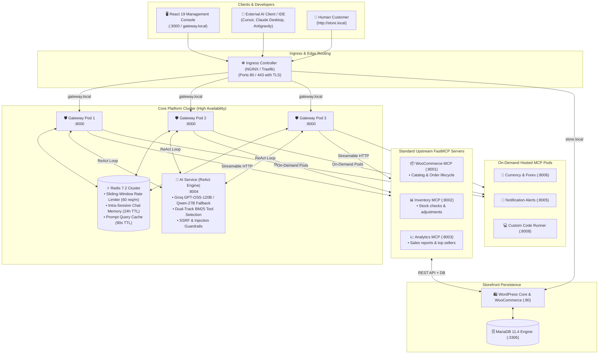

# Urumi Enterprise Model Context Protocol (MCP) Gateway Platform

[](https://kubernetes.io/)
[](https://helm.sh/)
[](https://www.docker.com/)
[](https://github.com/jlowin/fastmcp)
[](https://groq.com/)
[](https://redis.io/)
[](https://vitejs.dev/)

An enterprise-grade, multi-tenant **Model Context Protocol (MCP) Gateway** deployed on Kubernetes and Docker. It provides a secure, unified reverse proxy and governance layer bridging external AI agents (Cursor, Claude Desktop, Antigravity, custom LLM copilots) and enterprise e-commerce microservices with **centralized RBAC, Redis chat session memory, dynamic BM25 tool retrieval, on-demand hosted MCP pods, SSRF guardrails, and automated multi-store tenant provisioning**.

---

## 📑 Table of Contents
1. [Repository & Deliverables Structure](#-repository--deliverables-structure)
2. [Quick Access URLs & Credentials](#-quick-access-urls--default-credentials)
3. [Architecture Overview](#-comprehensive-platform-architecture)
4. [Local Setup Instructions (Kind & Docker Compose)](#-local-setup-instructions)
5. [Production VPS Setup Instructions (k3s & Helm)](#-production-vps-setup-instructions-k3s)
6. [How-To Guides](#-how-to-guides)
   - [Placing an Order via Storefront & REST](#1-how-to-place-an-order)
   - [Connecting an External MCP Client (Cursor, Claude Desktop)](#2-connecting-an-external-mcp-client)
   - [Using the Chat Agent](#3-using-the-chat-agent)
   - [Provisioning Multi-Store Tenants](#4-provisioning-multi-store-tenants)
   - [Prometheus Monitoring & Observability](#5-prometheus-monitoring--observability)
7. [Source Code Components](#-source-code-components)
8. [Helm Charts & Values Files](#-helm-charts--values-files)
9. [System Design and Tradeoffs Summary](#-system-design-and-tradeoffs-summary)
10. [Threat Model Summary](#-threat-model-summary)
11. [Bonus & Stand-Out Items Catalog](#-bonus--stand-out-items-catalog)
12. [Evaluation & Testing Suites](#-evaluation--testing-suites)

---

## 📂 Repository & Deliverables Structure

```
.
├── apps/
│   ├── frontend/                  # [Deliverable 2] React 19 Management Console & Chat UI
│   ├── gateway/                   # [Deliverable 2] MCP Gateway, Router, RBAC, Redis Cache & Rate Limiter
│   └── ai-service/                # [Deliverable 2] ReAct LLM Agent Engine, BM25 Tool Selection & Guardrails
├── services/
│   ├── woocommerce-mcp/           # [Deliverable 2] WooCommerce FastMCP Server (Catalog & Orders)
│   ├── inventory-mcp/             # Inventory FastMCP Server (Real-time Stock & Batches)
│   ├── analytics-mcp/             # Analytics FastMCP Server (Sales, Revenue, Top Sellers)
│   └── hosted-mcp/                # On-demand Hosted MCP Pods (Forex, Notifications, Custom Code)
├── infra/
│   ├── helm/urumi-platform/       # [Deliverable 3] Production Helm Chart
│   │   ├── values.yaml            # Base chart values
│   │   ├── values-kind.yaml       # [Deliverable 3] Local development overrides
│   │   └── values-vps.yaml        # [Deliverable 3] Production VPS / k3s overrides with TLS
│   └── k8s/                       # Raw Kubernetes manifests & Kind cluster configuration
├── docs/
│   ├── system_design_and_tradeoffs.md  # [Deliverable 4] Complete Architecture & Tradeoffs Note
│   ├── threat_model.md                 # [Deliverable 5] Threat Model & Security Note
│   └── production_vps_deployment.md    # Turnkey VPS deployment runbook
├── report/
│   ├── report.tex                 # [Final Deliverable] 15-Page Comprehensive Walkthrough Report in LaTeX
│   └── report.pdf                 # [Final Deliverable] Compiled PDF Submission Document
├── scripts/                       # Automated testing, benchmarking, and bootstrapping scripts
├── docker-compose.yml             # Single-host production compose stack (11 microservices)
└── README.md                      # [Deliverable 1] Master documentation and runbook
```

---

## 🌐 Quick Access URLs & Default Credentials

| Service / Interface | Local / VPS URL | Default Credentials | Description |
| :--- | :--- | :--- | :--- |
| **Urumi Management Console** | **[http://localhost:3000](http://localhost:3000)** | *Pre-authenticated via Studio* | React 19 / Vite console with Live Chat, Telemetry, and Policy Studio |
| **In-Cluster Gateway API** | **[http://gateway.local](http://gateway.local)** | `X-API-Key: admin-key-urumi-2026` | Unified reverse proxy, tool router, and auth enforcement |
| **WooCommerce Storefront** | **[http://store.local](http://store.local)** | *Public catalog & checkout* | Official live WooCommerce storefront with real-time stock sync |
| **WordPress Admin Dashboard** | **[http://store.local/wp-admin](http://store.local/wp-admin)** | **Username:** `admin`<br/>**Password:** `AdminPassword123!` | Official merchant back-office for products, orders, and REST API |
| **Tenant Store (Tech Store)** | **[http://tech.store.local](http://tech.store.local)** | Managed via Gateway tools | Ephemeral provisioned tenant store with isolated namespace |

> [!NOTE]
> Ensure `127.0.0.1 store.local gateway.local tech.store.local` is mapped in `/etc/hosts` (or `C:\Windows\System32\drivers\etc\hosts` on Windows).

---

## 🏛️ Comprehensive Platform Architecture



---

## 💻 Local Setup Instructions

You can spin up the full local platform using either **Kubernetes (Kind)** or **Docker Compose**.

### Method 1: Local Kubernetes (Kind) - Recommended

```bash
# 1. Clone repository
git clone https://github.com/<your-username>/urumi-mcp-gateway.git
cd urumi-mcp-gateway

# 2. Add local host mappings
echo "127.0.0.1 store.local gateway.local tech.store.local" | sudo tee -a /etc/hosts

# 3. Create Kind cluster with ingress port mappings (80 & 443)
kind create cluster --name urumi-local --config infra/k8s/kind-config.yaml

# 4. Install NGINX Ingress Controller
kubectl apply -f https://raw.githubusercontent.com/kubernetes/ingress-nginx/main/deploy/static/provider/kind/deploy.yaml
kubectl wait --namespace ingress-nginx --for=condition=ready pod --selector=app.kubernetes.io/component=controller --timeout=120s

# 5. Create Groq API Key Secret
kubectl create secret generic groq-api-key --from-literal=GROQ_API_KEY="your_groq_api_key_here"

# 6. Deploy platform using Helm with local Kind values
helm upgrade --install storefront infra/helm/urumi-platform -f infra/helm/urumi-platform/values.yaml -f infra/helm/urumi-platform/values-kind.yaml

# 7. Seed WooCommerce store with products & demo orders
bash scripts/seed-woocommerce.sh

# 8. Start local frontend dashboard
cd apps/frontend && npm install && npm run dev
```

### Method 2: Turnkey Docker Compose (Single Host)

```bash
# 1. Configure environment variables
cp .env.example .env
nano .env # insert your GROQ_API_KEY

# 2. Launch all 11 microservices in detached mode
docker compose up -d

# 3. Verify container status
docker compose ps
```

---

## ☁️ Production VPS Setup Instructions (k3s)

Deploy on any bare Ubuntu/Debian VPS or cloud compute instance ($5–$12/month Hetzner/DigitalOcean/AWS).

### 1. Install k3s Lightweight Kubernetes
```bash
curl -sfL https://get.k3s.io | INSTALL_K3S_EXEC="--disable traefik" sh -
mkdir -p ~/.kube && sudo cp /etc/rancher/k3s/k3s.yaml ~/.kube/config && sudo chown $USER:$USER ~/.kube/config
```

### 2. Install Ingress Controller & cert-manager (Automated TLS)
```bash
# Install Helm 3
curl https://raw.githubusercontent.com/helm/helm/main/scripts/get-helm-3 | bash

# Install NGINX Ingress Controller
helm repo add ingress-nginx https://kubernetes.github.io/ingress-nginx
helm repo update
helm install ingress-nginx ingress-nginx/ingress-nginx --set controller.service.type=LoadBalancer

# Install cert-manager
kubectl apply -f https://github.com/cert-manager/cert-manager/releases/download/v1.17.1/cert-manager.yaml
```

### 3. Deploy Platform via Production Helm Overrides
```bash
# 1. Create Groq API Secret
kubectl create secret generic groq-api-key --from-literal=GROQ_API_KEY="your_groq_api_key_here"

# 2. Deploy using production values (uses local-path storageClass, TLS annotations, and 3 Gateway replicas)
helm upgrade --install storefront infra/helm/urumi-platform \
  -f infra/helm/urumi-platform/values.yaml \
  -f infra/helm/urumi-platform/values-vps.yaml \
  --set global.domain="your-domain.com"
```

For complete VPS troubleshooting and DNS mapping instructions, see [docs/production_vps_deployment.md](docs/production_vps_deployment.md).

---

## 📖 How-To Guides

### 1. How to Place an Order
You can place customer orders through three distinct channels:

#### A. Via the Live WooCommerce Storefront (Web UI)
1. Open your browser and navigate to **[http://store.local](http://store.local)**.
2. Browse products (e.g. *Gaming Chair Pro*, *Wireless Noise-Canceling Earbuds*, *Ergonomic Mechanical Keyboard*).
3. Click **Add to Cart**, then proceed to **Checkout**.
4. Fill in billing details and complete checkout using the test payment gateway.

#### B. Via the AI Chat Agent (Natural Language)
In the Management Console (`http://localhost:3000`) or through any connected MCP client, submit:
```
"Place an order for John Doe (john@example.com) for 2 units of URUMI-EAR-001 (Earbuds Pro)."
```
The agent automatically calls `woocommerce__create_order` and reports the generated Order ID and total cost.

#### C. Via Direct Gateway REST API
```bash
curl -X POST http://gateway.local/api/v1/tools/execute \
  -H "X-API-Key: admin-key-urumi-2026" \
  -H "Content-Type: application/json" \
  -d '{
    "name": "woocommerce__create_order",
    "arguments": {
      "customer_email": "jane@example.com",
      "line_items": [{"sku": "URUMI-CHR-001", "quantity": 1}],
      "payment_method": "bacs"
    }
  }'
```

---

### 2. Connecting an External MCP Client

The Urumi Gateway exposes an official Model Context Protocol endpoint supporting both **Streamable HTTP** and **Server-Sent Events (SSE)**.

#### A. Connecting Cursor IDE
In Cursor settings:
1. Open **Cursor Settings** $\rightarrow$ **Features** $\rightarrow$ **MCP Servers**.
2. Click **Add New MCP Server**.
3. Configure:
   - **Name:** `Urumi Gateway`
   - **Type:** `sse`
   - **URL:** `http://gateway.local/mcp` (or `http://localhost:8000/mcp`)
   - **Headers:** `{"X-API-Key": "admin-key-urumi-2026"}`

#### B. Connecting Claude Desktop
Edit your Claude Desktop configuration file:
- **macOS:** `~/Library/Application Support/Claude/claude_desktop_config.json`
- **Windows:** `%APPDATA%\Claude\claude_desktop_config.json`

```json
{
  "mcpServers": {
    "urumi-gateway": {
      "url": "http://localhost:8000/mcp",
      "headers": {
        "X-API-Key": "admin-key-urumi-2026"
      }
    }
  }
}
```

#### C. Connecting via Python / FastMCP Client
```python
from fastmcp import Client

async with Client(url="http://localhost:8000/mcp", headers={"X-API-Key": "admin-key-urumi-2026"}) as client:
    tools = await client.list_tools()
    print(f"Discovered {len(tools)} tools across Urumi platform!")
    res = await client.call_tool("woocommerce__list_products", {})
    print(res)
```

---

### 3. Using the Chat Agent

1. Navigate to **[http://localhost:3000](http://localhost:3000)** in your browser and switch to the **"Chat Agent"** tab.
2. Select your authenticated Persona/Role in the sidebar:
   - **Administrator**: Full catalog, order mutation, warehouse stock adjustment, analytics, and forex tools.
   - **Inventory Manager**: Stock inspections and relative adjustments.
   - **Support Rep**: Catalog lookups, order status updates, and tracking.
3. Try standard prompts:
   - *"What are our top 3 best-selling products this month, and what is our current warehouse stock for each?"*
   - *"How much stock is left for the Ergonomic Mechanical Keyboard, and what would 5 units cost in Euros?"*
   - *"Find order #101 and update its status to completed."*
4. **Session Persistence**: Refresh your browser (`F5`); your dialogue history is instantly restored from Redis.
5. **Resetting Session**: Click the **Reset** button or call `DELETE /api/v1/chat/history` to wipe conversation memory.

---

### 4. Provisioning Multi-Store Tenants

The platform includes an autonomous tenant factory allowing instant deployment of isolated e-commerce stores:

#### A. Provision a Store via UI Console
1. Navigate to **[http://localhost:3000](http://localhost:3000)** and select the **"Stores"** tab.
2. Click **Create New Store**, enter store name and slug (e.g. `tech-store`), and click **Provision**.
3. The platform deploys a dedicated Kubernetes namespace (`store-tech`), boots isolated MariaDB and WordPress pods, and auto-registers tenant-scoped tools (`store_tech__*`).

#### B. Provision via Gateway REST API
```bash
curl -X POST http://gateway.local/api/v1/stores/provision \
  -H "X-API-Key: admin-key-urumi-2026" \
  -H "Content-Type: application/json" \
  -d '{
    "name": "Electronics Store",
    "slug": "electronics",
    "admin_email": "admin@electronics.local"
  }'
```

#### C. Lifecycle Verification & Automated Tests
Verify tenant creation, dynamic prefix routing, and cascade teardown:
```bash
python scripts/test_multi_store.py
```

---

### 5. Prometheus Monitoring & Observability

The Gateway implements an in-memory telemetry collector and exposes standard OpenMetrics on `/metrics` for Prometheus and Grafana scrapers.

#### A. Querying Metrics Endpoint
```bash
curl -s http://gateway.local/metrics
# or inside Kubernetes cluster:
# curl -s http://gateway.default.svc.cluster.local:8000/metrics
```

#### B. Exposed Metric Dimensions
- `mcp_gateway_uptime_seconds`: Total runtime of the Gateway.
- `mcp_tool_calls_total{status="success|error"}`: Cumulative tool execution attempts.
- `mcp_rbac_violations_total`: Unauthorized tool invocation attempts blocked by RBAC.
- `mcp_rate_limit_blocks_total`: HTTP 429 requests throttled by sliding-window rate limiters.
- `mcp_upstream_server_status{server_id="..."}`: Health state (1=Connected, 0=Down).
- `mcp_circuit_breaker_state{server_id="..."}`: Circuit breaker state (0=CLOSED, 1=OPEN, 2=HALF_OPEN).
- `mcp_server_requests_total{server_id="...",status="..."}`: Volume grouped by upstream microservice.
- `mcp_server_latency_seconds_p95{server_id="..."}`: 95th percentile latency distribution per upstream.
- `mcp_tool_execution_count{tool="..."}`: Granular execution frequency counter per tool.

#### C. Prometheus Scrape Configuration (Helm)
The Gateway Deployment and Service templates include native Prometheus scrape annotations:
```yaml
annotations:
  prometheus.io/scrape: "true"
  prometheus.io/port: "8000"
  prometheus.io/path: "/metrics"
```
Prometheus server automatically discovers all Gateway replicas and scrapes metrics every 15 seconds. High-resolution telemetry JSON is also accessible in real time via `GET /api/v1/telemetry` for the React dashboard.

---

## 📦 Source Code Components

- **`apps/frontend`**: React 19 single-page application built with Vite and Tailwind CSS. Contains the interactive Chat Console, Live Tool Telemetry Inspector, RBAC Policy Studio, and Tenant Store Lifecycle Manager.
- **`apps/gateway`**: The core FastAPI gateway. Implements authentication (`api_keys.py`), zero-trust authorization (`rbac.py`), sliding-window rate limiting (`rate_limiter.py`), Redis session memory & caching (`chat_memory.py`), and dynamic tool aggregation (`server.py`).
- **`apps/ai-service`**: Autonomous ReAct agent engine (`agent.py`). Integrates Groq LLMs (`openai/gpt-oss-120b` and `qwen/qwen3.8-27b`), dual-track BM25 tool selection (`retrieval.py`), and security guardrails (`guardrails.py`).
- **`services/woocommerce-mcp`**: FastMCP service communicating directly with WooCommerce REST APIs and MariaDB backend to manage products, categories, orders, and metadata.
- **`services/inventory-mcp`**: Dedicated FastMCP warehouse service providing atomic stock verifications, batch checks, and audited stock adjustments.
- **`services/analytics-mcp`**: Dedicated FastMCP analytics engine providing daily gross sales, 30-day revenue summaries, and top-seller aggregations.
- **`services/hosted-mcp`**: Containerized ephemeral MCP pods for currency conversion, Slack/email notifications, and custom code execution.

---

## ☸️ Helm Charts & Values Files

The platform includes a production-ready Helm chart located in `infra/helm/urumi-platform/`:
- **`values.yaml`**: Complete configuration tree defining container images, resource requests/limits, MariaDB credentials, replica counts, and probe timings.
- **`values-kind.yaml`**: Environment override for local development inside Kind clusters (uses `hostPath` persistent volumes and plaintext HTTP ingress).
- **`values-vps.yaml`**: Hardened production override for k3s and cloud clusters. Configures 3 Gateway replicas, `local-path` storageClass, Let's Encrypt TLS annotations, and public domain routing.

---

## 📐 System Design and Tradeoffs Summary

For full technical details, consult **[docs/system_design_and_tradeoffs.md](docs/system_design_and_tradeoffs.md)**.

* **Architecture**: Microservice decomposition over monolith isolates high-risk analytical queries from critical store checkout paths. FastMCP over HTTP/SSE enables native Kubernetes load balancing, ingress routing, and health probing.
* **Tool Aggregation & Routing**: Dynamic prefix-based routing (`<server>__<tool>`) decouples clients from internal topologies. Tools are discovered asynchronously on startup and filtered via caller RBAC.
* **Failure Handling**:
  - *Circuit Breaker*: Upstream server crashes open a 30s circuit breaker, returning structured 503 errors rather than hanging client requests.
  - *Asynchronous Timeouts*: Strict 8.0s timeout per tool call prevents worker pool exhaustion.
  - *Model Failover*: Automatic 500ms fallback from 120B to 27B LLM prevents 429 token-per-minute stalls.
* **Production Delta**: Local host aliases replaced with public FQDNs; plaintext HTTP upgraded to TLS 1.3 via `cert-manager`; ephemeral storage replaced with dynamic `local-path`/CSI volumes; secrets managed via Kubernetes `Secret` objects.

---

## 🛡️ Threat Model Summary

For full security analysis, consult **[docs/threat_model.md](docs/threat_model.md)**.

* **Shared Upstream Credentials**: Upstream WooCommerce REST keys and database passwords terminate strictly at the Gateway and are **never inserted into the LLM system prompt**. Members interact exclusively through least-privilege RBAC roles.
* **Client Token Non-Passthrough**: Terminating client tokens at the perimeter prevents token leakage to untrusted third-party upstreams and allows the Gateway to act as a secure token translation bridge.
* **Untrusted Upstream Defense**: Tool descriptions undergo schema sanitization and markdown stripping to eliminate prompt injection and instructions hijacking. Execution-time RBAC ensures that even if an LLM is deceived, unauthorized tool invocations are blocked with `403 Forbidden`.
* **Cross-Member Isolation**: Dialogue memory is isolated by cryptographic session IDs; horizontal privilege escalation and role-override attempts are intercepted and recorded in immutable audit logs.

---

## 🏆 Bonus & Stand-Out Items Catalog

| # | Stand-Out Feature | Description | File Location |
| :---: | :--- | :--- | :--- |
| **1** | **Production VPS (k3s) Deployment with TLS** | Turnkey production Helm values with `local-path` storage, 3 Gateway replicas, and automated `cert-manager` Let's Encrypt TLS. | [`infra/helm/urumi-platform/values-vps.yaml`](infra/helm/urumi-platform/values-vps.yaml)<br/>[`docs/production_vps_deployment.md`](docs/production_vps_deployment.md) |
| **2** | **Distributed Redis Session Memory** | Sub-millisecond conversation memory with 24-hour TTL, saving ~850 tokens and 1.2 KB payload per turn on page refresh. | [`apps/gateway/chat_memory.py`](apps/gateway/chat_memory.py) |
| **3** | **Redis Prompt Caching & Model Failover** | 90s idempotent prompt cache cutting latency from 31s to 14.6ms (2,146x speedup) with instant Groq failover. | [`apps/gateway/server.py`](apps/gateway/server.py)<br/>[`apps/ai-service/agent.py`](apps/ai-service/agent.py) |
| **4** | **Dual-Track BM25 Tool Retrieval** | In-memory ranker indexing 26+ tools, cutting prompt tokens by 65%–80% and halving Time-to-First-Token. | [`apps/ai-service/retrieval.py`](apps/ai-service/retrieval.py) |
| **5** | **On-Demand Hosted MCP Pods** | In-cluster lifecycle management (scale-to-0, wake, logs) for Currency, Notifications, and Custom Code MCPs. | [`services/hosted-mcp/server.py`](services/hosted-mcp/server.py)<br/>[`apps/gateway/server.py`](apps/gateway/server.py) |
| **6** | **Autonomous Multi-Store Provisioning** | Dynamic tenant factory provisioning isolated namespaces (`store-<slug>`) with dedicated MariaDB, WordPress, and tools. | [`apps/gateway/server.py`](apps/gateway/server.py)<br/>[`scripts/test_multi_store.py`](scripts/test_multi_store.py) |
| **7** | **Interactive React 19 Console & Studio** | Management console with live SSE streaming, tool telemetry timeline, and dynamic visual RBAC policy editor. | [`apps/frontend/src/views/`](apps/frontend/src/views/) |

---

## 🧪 Evaluation & Testing Suites

All test suites can be run against either local Kind or production VPS deployments:

```bash
# 1. 30-Prompt End-to-End Evaluation Test Matrix
python scripts/test_25_prompts_matrix.py

# 2. 20-Scenario Advanced Cross-MCP Orchestration Suite
python scripts/test_advanced_multi_mcp.py

# 3. 23-Point Security & RBAC Penetration Scanner
python scripts/vuln_scanner.py

# 4. Multi-Store Tenant Lifecycle Test
python scripts/test_multi_store.py

# 5. Redis Prompt Caching & Latency Benchmark
python scripts/benchmark_latency_cache.py
```

---

## 🚢 Docker Hub Repositories

All platform images are published and publicly accessible under the `hiensenbergg` Docker Hub registry:
- `docker.io/hiensenbergg/mcp-gateway:v1.6.8` / `latest`
- `docker.io/hiensenbergg/ai-service:v1.3.8` / `latest`
- `docker.io/hiensenbergg/frontend:v1.0.0` / `latest`
- `docker.io/hiensenbergg/woocommerce-mcp:v1.1.0` / `latest`
- `docker.io/hiensenbergg/inventory-mcp:v1.1.1` / `latest`
- `docker.io/hiensenbergg/analytics-mcp:v1.1.0` / `latest`
- `docker.io/hiensenbergg/hosted-mcp:v1.0.0` / `latest`

---

## 📄 License
MIT License. Built for the Urumi AI Forward Deployed Engineer (FDE) Evaluation.
