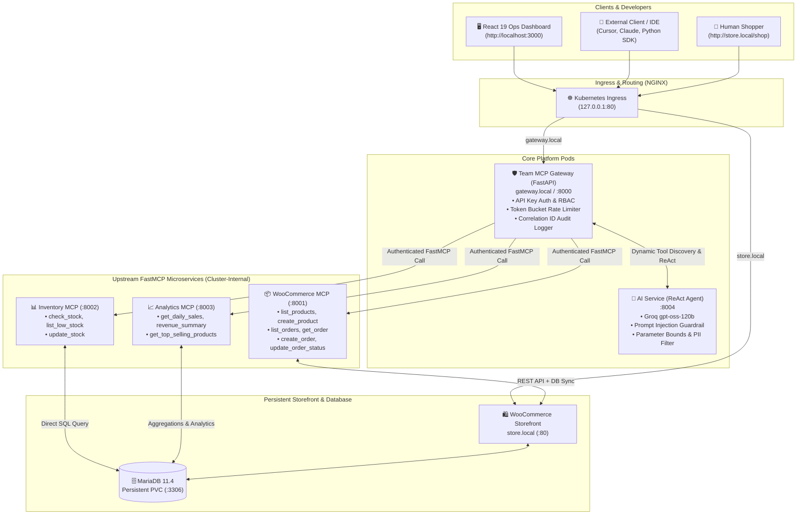

# Team MCP Gateway on Kubernetes

[](https://kubernetes.io/)
[](https://helm.sh/)
[](https://github.com/jlowin/fastmcp)
[](https://groq.com/)
[](https://vitejs.dev/)

An enterprise-grade, secure, multi-tenant **Model Context Protocol (MCP) Gateway** deployed on Kubernetes. It bridges AI agents, external developer tools (Cursor, Claude, Antigravity, MCP Inspector), and enterprise microservices with **centralized RBAC, audit logging, rate limiting, and dual-layer safety guardrails**.

---

## 🏛️ System Architecture



---

## ✨ Key Features & Enterprise Controls

### 1. Multi-Tenant Role-Based Access Control (RBAC)
Every incoming request requires a Bearer API token. The Gateway enforces strict least-privilege policies across 12 namespaced tools:

| Role | Permitted Tools | Forbidden Tools | Use Case |
| :--- | :--- | :--- | :--- |
| **`admin`** | All 12 tools (`woocommerce__*`, `inventory__*`, `analytics__*`) | None | System administrators & DevOps |
| **`inventory_manager`** | `inventory__check_stock`, `inventory__list_low_stock`, `inventory__update_stock`, `woocommerce__list_products` | `woocommerce__create_order`, `analytics__*` | Warehouse & fulfillment team |
| **`analyst`** | `analytics__get_daily_sales`, `analytics__get_revenue_summary`, `analytics__get_top_selling_products`, `woocommerce__list_products`, `woocommerce__list_orders` | `inventory__update_stock`, `woocommerce__create_product`, `woocommerce__create_order` | Business intelligence & reporting |
| **`support_rep`** | `woocommerce__list_orders`, `woocommerce__get_order`, `woocommerce__update_order_status`, `inventory__check_stock` | Financial analytics & stock updates | Customer service agents |

### 2. Upstream Credential Isolation & Untrusted Upstream Defense
- **Zero Client Credential Leakage:** Upstream database credentials and WooCommerce REST API consumer keys/secrets reside exclusively in Kubernetes Secrets inside the cluster. External clients only possess Gateway API keys.
- **Upstream Failure Isolation:** All calls to upstream servers run under an asynchronous 15-second timeout with failure isolation. If an upstream pod crashes or fails, the Gateway logs the error and returns a clean `502 Bad Gateway` without crashing or interrupting traffic to healthy upstreams.

### 3. Dual-Layer AI Safety Guardrails
The AI reasoning engine (`apps/ai-service`) executes pre- and post-invocation safety hooks:
1. **Prompt Injection Defense:** Scans user prompts against adversarial patterns (system prompt overrides, role hijack attempts, jailbreak prefixes).
2. **Parameter Boundary Validation:** Enforces positive bounds on price, stock quantities, and order counts before dispatching tool calls.
3. **PII & Secret Sanitization:** Regex redactions scrub credit card patterns, social security numbers, and bearer secrets from agent outputs.

### 4. Correlation-ID Audit Logging & Observability
Every execution is tracked in an in-memory & persistent log stream with:
- Correlation ID (`req-xxxxxxxxxx`)
- Principal name and assigned role
- Target upstream service and tool name
- Sub-millisecond execution duration
- Sanitized parameters and HTTP lifecycle status (`200 OK`, `403 Blocked`, `502 Error`)

---

## 🚀 Quickstart & Deployment

### Prerequisites
- Docker Desktop with Kubernetes enabled (or `kind` / `minikube`)
- Helm v3
- Python 3.12+ (for running test suites)
- Node.js 18+ (for frontend dashboard)

### 1. Configure Local DNS Resolution
Add the following entry to your `hosts` file (`C:\Windows\System32\drivers\etc\hosts` or `/etc/hosts`):
```text
127.0.0.1 store.local gateway.local
```

### 2. Deploy the Kubernetes Stack via Helm
The entire platform deploys with a single Helm command:
```bash
helm upgrade --install storefront ./infra/helm/urumi-platform --values ./infra/helm/urumi-platform/values.yaml
```

Verify all pods are running:
```bash
kubectl get pods
# Expected output:
# NAME                               READY   STATUS    RESTARTS   AGE
# ai-service-xxxxxxxxxx-xxxxx        1/1     Running   0          ...
# analytics-mcp-xxxxxxxxxx-xxxxx     1/1     Running   0          ...
# gateway-xxxxxxxxxx-xxxxx           1/1     Running   0          ...
# inventory-mcp-xxxxxxxxxx-xxxxx     1/1     Running   0          ...
# mariadb-xxxxxxxxxx-xxxxx           1/1     Running   0          ...
# woocommerce-mcp-xxxxxxxxxx-xxxxx   1/1     Running   0          ...
# wordpress-xxxxxxxxxx-xxxxx         1/1     Running   0          ...
```

### 3. Launch the Operations Dashboard
```bash
cd apps/frontend
npm install
npm run dev
# Dashboard running at http://localhost:3000
```

---

## 🧪 Definition of Done: End-to-End Flow Verification

This platform satisfies the full end-to-end verification flow:

### Step 1: Browse & Order via Storefront
1. Navigate to **[http://store.local/](http://store.local/)**.
2. Notice the modern Storefront theme with high-resolution product photography, live status banners, and USD pricing.
3. Add **"Dynamic Studio Mic Boom"** ($89.50) to cart and proceed to checkout.
4. Place order using **Cash on Delivery (COD)**.

### Step 2: Automatic Inventory Decrement
WooCommerce triggers automatic stock deduction:
- Initial warehouse stock: `39` units
- Post-checkout stock: `38` units (synced in MariaDB `wp_postmeta`)

### Step 3: Ask the AI Operations Agent
In the Operations Dashboard at **`http://localhost:3000`** (or via API):
> *"What orders were placed today, and what is our current stock for the microphone boom?"*

The agent autonomously ReActs:
1. Calls `woocommerce__list_orders` → Retrieves Order #26 ($89.50, COD).
2. Calls `inventory__check_stock` (`sku`: `SKU-DYN-6`) → Confirms stock is now 38 units.
3. Formats response in clean Markdown with live tool execution cards.

---

## 🔌 External Client Integration (User B Flow)

External agents, IDEs (Cursor, Claude Code, Antigravity), or scripts can connect to the Gateway as an external client using a scoped API key:

### Using cURL
```bash
# 1. Discover allowed tools for User B (Inventory Manager)
curl -s -H "Authorization: Bearer inv-key-urumi-2026" \
     -H "Host: gateway.local" \
     http://127.0.0.1/api/v1/tools

# 2. Check stock level (Allowed)
curl -s -X POST \
     -H "Authorization: Bearer inv-key-urumi-2026" \
     -H "Host: gateway.local" \
     -H "Content-Type: application/json" \
     -d '{"tool": "inventory__check_stock", "arguments": {"sku": "SKU-1001"}}' \
     http://127.0.0.1/api/v1/tools/call

# 3. Attempt financial revenue summary (Blocked with HTTP 403)
curl -s -X POST \
     -H "Authorization: Bearer inv-key-urumi-2026" \
     -H "Host: gateway.local" \
     -H "Content-Type: application/json" \
     -d '{"tool": "analytics__get_revenue_summary", "arguments": {}}' \
     http://127.0.0.1/api/v1/tools/call
# Returns: {"detail": "Permission Denied: Role 'inventory_manager' is not authorized to execute tool 'analytics__get_revenue_summary'."}
```

### Connecting from Claude Desktop / Cursor (`mcpServers` config)
Add to your `claude_desktop_config.json` or Cursor MCP settings:
```json
{
  "mcpServers": {
    "urumi-team-gateway": {
      "command": "python",
      "args": ["-m", "mcp_proxy", "--url", "http://gateway.local/mcp", "--token", "inv-key-urumi-2026"]
    }
  }
}
```

---

## 🔒 Security & Threat Model

1. **Shared Upstream Credentials Risk:**
   - *Threat:* Compromise of an external client could expose sensitive WooCommerce API keys or MariaDB credentials.
   - *Mitigation:* Upstream credentials never leave the Kubernetes cluster. The Gateway accepts only ephemeral client tokens and proxies calls internally using Kubernetes Service DNS.
2. **Untrusted Upstream Microservice Risk:**
   - *Threat:* A compromised or malicious upstream MCP server returns malformed payloads or attempts SSRF against internal cluster services.
   - *Mitigation:* Strict HTTP timeouts (15s), response schema validation, and isolation from cluster metadata endpoints.
3. **Prompt Injection & Model Manipulation:**
   - *Threat:* Malicious user input in support chats attempts to manipulate the agent into invoking unauthorized write actions (`woocommerce__update_order_status`).
   - *Mitigation:* Defense-in-depth: Even if prompt injection bypasses the AI layer, the Gateway's deterministic RBAC engine will intercept and reject any tool not permitted for the client's token.

---

## 📊 Automated Test Coverage

The platform features comprehensive automated test suites across all layers:

```bash
# Run all Phase 1-5 test suites
pytest -v tests/
```

- [`tests/test_phase1_gateway.py`](file:///d:/urumi%20assignment/tests/test_phase1_gateway.py): Gateway health, tool routing, and rate limiting.
- [`tests/test_phase2_rbac.py`](file:///d:/urumi%20assignment/tests/test_phase2_rbac.py): RBAC permission matrices and token validation.
- [`tests/test_phase3_audit.py`](file:///d:/urumi%20assignment/tests/test_phase3_audit.py): Audit logging schema, correlation IDs, and query filters.
- [`tests/test_phase4_ai_service.py`](file:///d:/urumi%20assignment/tests/test_phase4_ai_service.py): AI ReAct loop, injection guardrails, parameter bounds, and PII filters.
- [`tests/test_phase5_e2e_gateway.py`](file:///d:/urumi%20assignment/tests/test_phase5_e2e_gateway.py): User B execution, dynamic key revocation, and full audit lifecycle.

---

## 📄 License
MIT License. Built for the Urumi AI Forward Deployed Engineer (FDE) Assignment.
