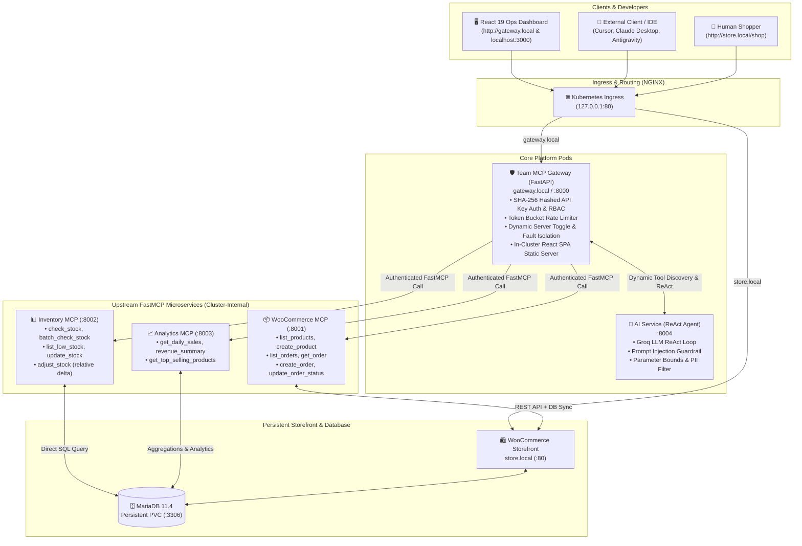

# Team MCP Gateway on Kubernetes

[](https://kubernetes.io/)
[](https://helm.sh/)
[](https://github.com/jlowin/fastmcp)
[](https://groq.com/)
[](https://vitejs.dev/)

An enterprise-grade, secure, multi-tenant **Model Context Protocol (MCP) Gateway** deployed on Kubernetes. It bridges AI agents, external developer tools (Cursor, Claude, Antigravity, MCP Inspector), and enterprise microservices with **centralized RBAC, audit logging, rate limiting, and dual-layer safety guardrails**.

---

## 🌐 Quick Access URLs

| Workload / Interface | Access URL | Description |
| :--- | :--- | :--- |
| **In-Cluster Ops Dashboard** | **[http://gateway.local](http://gateway.local)** | Production React 19 UI served directly by the Gateway container inside Kubernetes |
| **Storefront (WooCommerce)** | **[http://store.local](http://store.local)** | Customer-facing store with Cash on Delivery (COD) payment |
| **WordPress Admin** | **[http://store.local/wp-admin](http://store.local/wp-admin)** | Store management (`admin` / `AdminPassword123!`) |
| **Local Dev Dashboard** | **[http://localhost:3000](http://localhost:3000)** | Vite development server with instant HMR hot-reloading |

---

## 🏛️ System Architecture



---

## ✨ Key Features & Enterprise Controls

### 1. Multi-Tenant Role-Based Access Control (RBAC)
Every incoming request requires a Bearer API token or `X-API-Key` header. The Gateway enforces strict least-privilege policies across 14 namespaced tools:

| Role | Permitted Tools | Forbidden Tools | Use Case |
| :--- | :--- | :--- | :--- |
| **`admin`** | All 14 tools (`woocommerce__*`, `inventory__*`, `analytics__*`) | None | System administrators & DevOps |
| **`inventory_manager`** | `inventory__check_stock`, `inventory__batch_check_stock`, `inventory__list_low_stock`, `inventory__update_stock`, `inventory__adjust_stock`, `woocommerce__list_products` | `woocommerce__create_order`, `analytics__*` | Warehouse & fulfillment team |
| **`analyst`** | `analytics__get_daily_sales`, `analytics__get_revenue_summary`, `analytics__get_top_selling_products`, `woocommerce__list_products`, `woocommerce__list_orders` | `inventory__update_stock`, `inventory__adjust_stock`, `woocommerce__create_product` | Business intelligence & reporting |
| **`support_rep`** | `woocommerce__list_products`, `woocommerce__list_orders`, `woocommerce__get_order`, `inventory__check_stock`, `inventory__batch_check_stock` | Financial analytics & stock mutations | Customer service agents |

### 2. Cryptographic API Key Storage & Masking
- **SHA-256 Hashing:** API keys are hashed with SHA-256 upon generation. Plaintext keys are revealed only once upon creation and never stored in raw text.
- **Credential Masking:** Key listings (`GET /api/v1/api-keys`) are restricted to administrators and always mask secrets (`admin-ke********`).

### 3. Upstream Fault Isolation & Dynamic Server Disabling
- **Deterministic Namespacing:** Tool naming collisions are resolved via double-underscore prefixes: `<server_prefix>__<tool_name>` (e.g. `woocommerce__list_orders`, `inventory__check_stock`).
- **Dynamic Server Disabling:** Admins can enable or disable upstream servers via `POST /api/v1/servers/{server_id}/toggle`. When disabled, tools immediately disappear from tool discovery and chat.
- **Upstream Failure Isolation:** All calls run under asynchronous timeouts (3.0s health, 15.0s tool execution). If an upstream pod crashes, the Gateway marks it `Unreachable` without cascading failure to healthy servers.

### 4. Dual-Layer AI Safety Guardrails
The AI reasoning engine (`apps/ai-service`) executes pre- and post-invocation safety hooks:
1. **Prompt Injection Defense:** Intercepts adversarial jailbreaks (*"Ignore all previous instructions..."*).
2. **Parameter Boundary Validation:** Enforces positive bounds on price, stock quantities, and order counts.
3. **PII & Secret Sanitization:** Redacts sensitive patterns, credit cards, and bearer tokens.

### 5. Correlation-ID Audit Logging & Observability
Every execution is tracked in an in-memory & persistent log stream with:
- Correlation ID (`req-xxxxxxxxxx`)
- Principal name and assigned role
- Target upstream service and tool name
- Sub-millisecond execution duration
- Sanitized parameters and HTTP lifecycle status (`200 OK`, `403 Blocked`, `502 Error`)

---

## 🚀 Quickstart & Deployment

### Prerequisites
- Docker Desktop with Kubernetes enabled (or `kind` / `minikube`)
- Helm v3
- Python 3.12+ (for running test suites)
- Node.js 18+ (for frontend dashboard)

### 1. Configure Local DNS Resolution
Add the following entry to your `hosts` file (`C:\Windows\System32\drivers\etc\hosts` or `/etc/hosts`):
```text
127.0.0.1 store.local gateway.local
```

### 2. Deploy the Kubernetes Stack via Helm
The entire platform deploys with a single Helm command:
```bash
helm upgrade --install storefront ./infra/helm/urumi-platform --values ./infra/helm/urumi-platform/values.yaml
```

Verify all pods are running:
```bash
kubectl get pods
# Expected output:
# NAME                               READY   STATUS    RESTARTS   AGE
# ai-service-xxxxxxxxxx-xxxxx        1/1     Running   0          ...
# analytics-mcp-xxxxxxxxxx-xxxxx     1/1     Running   0          ...
# gateway-xxxxxxxxxx-xxxxx           1/1     Running   0          ...
# inventory-mcp-xxxxxxxxxx-xxxxx     1/1     Running   0          ...
# mariadb-xxxxxxxxxx-xxxxx           1/1     Running   0          ...
# woocommerce-mcp-xxxxxxxxxx-xxxxx   1/1     Running   0          ...
# wordpress-xxxxxxxxxx-xxxxx         1/1     Running   0          ...
```

### 3. Launch the Operations Dashboard
```bash
cd apps/frontend
npm install
npm run dev
# Dashboard running at http://localhost:3000
```

---

## 🧪 Definition of Done: End-to-End Flow Verification

This platform satisfies the full end-to-end verification flow:

### Step 1: Browse & Order via Storefront
1. Navigate to **[http://store.local/](http://store.local/)**.
2. Notice the modern Storefront theme with high-resolution product photography, live status banners, and USD pricing.
3. Add **"Dynamic Studio Mic Boom"** ($89.50) to cart and proceed to checkout.
4. Place order using **Cash on Delivery (COD)**.

### Step 2: Automatic Inventory Decrement
WooCommerce triggers automatic stock deduction:
- Initial warehouse stock: `39` units
- Post-checkout stock: `38` units (synced in MariaDB `wp_postmeta`)

### Step 3: Ask the AI Operations Agent
In the Operations Dashboard at **`http://localhost:3000`** (or via API):
> *"What orders were placed today, and what is our current stock for the microphone boom?"*

The agent autonomously ReActs:
1. Calls `woocommerce__list_orders` → Retrieves Order #26 ($89.50, COD).
2. Calls `inventory__check_stock` (`sku`: `SKU-DYN-6`) → Confirms stock is now 38 units.
3. Formats response in clean Markdown with live tool execution cards.

---

## 🔌 External Client Integration (User B Flow)

External agents, IDEs (Cursor, Claude Code, Antigravity), or scripts can connect to the Gateway as an external client using a scoped API key:

### Using cURL
```bash
# 1. Discover allowed tools for User B (Inventory Manager)
curl -s -H "Authorization: Bearer inv-key-urumi-2026" \
     -H "Host: gateway.local" \
     http://127.0.0.1/api/v1/tools

# 2. Check stock level (Allowed)
curl -s -X POST \
     -H "Authorization: Bearer inv-key-urumi-2026" \
     -H "Host: gateway.local" \
     -H "Content-Type: application/json" \
     -d '{"tool": "inventory__check_stock", "arguments": {"sku": "SKU-1001"}}' \
     http://127.0.0.1/api/v1/tools/call

# 3. Attempt financial revenue summary (Blocked with HTTP 403)
curl -s -X POST \
     -H "Authorization: Bearer inv-key-urumi-2026" \
     -H "Host: gateway.local" \
     -H "Content-Type: application/json" \
     -d '{"tool": "analytics__get_revenue_summary", "arguments": {}}' \
     http://127.0.0.1/api/v1/tools/call
# Returns: {"detail": "Permission Denied: Role 'inventory_manager' is not authorized to execute tool 'analytics__get_revenue_summary'."}
```

### Connecting from Claude Desktop / Cursor (`mcpServers` config)
Add to your `claude_desktop_config.json` or Cursor MCP settings:
```json
{
  "mcpServers": {
    "urumi-gateway": {
      "command": "python",
      "args": [
        "scripts/antigravity_mcp_bridge.py"
      ],
      "env": {
        "GATEWAY_API_KEY": "admin-key-urumi-2026",
        "GATEWAY_URL": "http://127.0.0.1",
        "GATEWAY_HOST_HEADER": "gateway.local"
      }
    }
  }
}
```

---

## 🔒 Security & Threat Model

1. **Shared Upstream Credentials Risk:**
   - *Threat:* Compromise of an external client could expose sensitive WooCommerce API keys or MariaDB credentials.
   - *Mitigation:* Upstream credentials never leave the Kubernetes cluster. The Gateway accepts only ephemeral client tokens and proxies calls internally using Kubernetes Service DNS.
2. **Untrusted Upstream Microservice Risk:**
   - *Threat:* A compromised or malicious upstream MCP server returns malformed payloads or attempts SSRF against internal cluster services.
   - *Mitigation:* Strict HTTP timeouts (15s), response schema validation, and isolation from cluster metadata endpoints.
3. **Prompt Injection & Model Manipulation:**
   - *Threat:* Malicious user input in support chats attempts to manipulate the agent into invoking unauthorized write actions (`woocommerce__update_order_status`).
   - *Mitigation:* Defense-in-depth: Even if prompt injection bypasses the AI layer, the Gateway's deterministic RBAC engine will intercept and reject any tool not permitted for the client's token.

---

## 📊 Automated Test Coverage & Vulnerability Scanner

The platform features automated regression and security test suites across all layers:

### 1. 23-Point Security & RBAC Scanner
```bash
python scripts/vuln_scanner.py
```
Validates zero-trust boundaries:
- ✅ Non-admin blocked from listing, generating, or revoking API keys
- ✅ Admin key listing masks secrets (`admin-ke********`)
- ✅ Privilege escalation rejection (`role_override='admin'`)
- ✅ 401 Unauthorized across all unauthenticated endpoints
- ✅ 8/8 RBAC cross-role matrix tests (Support Rep, Inventory Manager, Analyst)
- ✅ Input boundary validation (negative quantities, extreme deltas, zero deltas)

### 2. Pytest Unit & Integration Tests
```bash
pytest -v tests/
```
- [`tests/test_phase1_gateway.py`](file:///d:/urumi%20assignment/tests/test_phase1_gateway.py): Gateway health, tool routing, and rate limiting.
- [`tests/test_phase2_rbac.py`](file:///d:/urumi%20assignment/tests/test_phase2_rbac.py): RBAC permission matrices and token validation.
- [`tests/test_phase3_audit.py`](file:///d:/urumi%20assignment/tests/test_phase3_audit.py): Audit logging schema, correlation IDs, and query filters.
- [`tests/test_phase4_ai_service.py`](file:///d:/urumi%20assignment/tests/test_phase4_ai_service.py): AI ReAct loop, injection guardrails, parameter bounds, and PII filters.
- [`tests/test_phase5_e2e_gateway.py`](file:///d:/urumi%20assignment/tests/test_phase5_e2e_gateway.py): User B execution, dynamic key revocation, and full audit lifecycle.

---

## 🏬 Bonus: Autonomous Multi-Store Provisioning Platform

The platform includes a complete **Kubernetes-native Multi-Store Provisioning Engine** that turns the single-store deployment into an ephemeral, multi-tenant SaaS store factory.

### Key Capabilities
1. **Dashboard Lifecycle Management:**
   - Administrators can provision and teardown store tenants on demand from the **"Stores"** tab.
   - Real-time progress indicators: 🟡 *Provisioning* $\rightarrow$ 🟢 *Ready* $\rightarrow$ 🔴 *Failed* $\rightarrow$ ⚪ *Deleting*.
2. **Kubernetes-Native Isolation:**
   - Every store is deployed into its own namespace (`store-<slug>`) with a dedicated MariaDB database, persistent volumes (PVCs), WordPress storefront, and WooCommerce MCP server.
   - **NetworkPolicy Enforcement:** Strict ingress/egress policies isolate tenant namespaces. Pods in `store-fashion` cannot communicate with or access databases in `store-tech`.
3. **Guardrails & Quotas:**
   - **`ResourceQuota`:** Limits CPU (500m request / 2000m limit), memory (800Mi request / 2Gi limit), PVCs (2), and pods (6) per tenant namespace.
   - **`LimitRange`:** Default container CPU and memory allocations.
   - **Store Quota:** Enforces a maximum cap of 5 concurrent active stores.
   - **Timeout Watchdog:** 180s timeout with automatic status reconciler and clear error reporting.
4. **Dynamic Tool Namespacing & Registration:**
   - When a tenant passes readiness probes, the Gateway automatically mounts its tools with tenant prefixes:
     - `store_tech__list_orders`
     - `store_tech__list_products`
     - `store_tech__create_order`
     - `store_tech__get_order`
   - The AI Agent dynamically binds to these tools without any manual configuration or platform restarts.
5. **Clean Teardown:**
   - Deleting a store unregisters its tools from the Gateway immediately and triggers an asynchronous cascade deletion of its Kubernetes namespace, destroying all pods, volumes, secrets, and network policies.
6. **Cross-Store AI Analytics:**
   - The AI Copilot can execute tools across multiple stores in a single conversation:
     > *"Compare the orders and order totals between Fashion Store and Tech Store."*
     The agent invokes `store_fashion__list_orders` and `store_tech__list_orders`, computing cross-store revenue gaps and average order values side-by-side in Markdown tables.

### Automated Multi-Store Test Suite
```bash
python scripts/test_multi_store.py
```
Validates:
- ✅ Store tenant discovery & status reconciliation
- ✅ Dynamic tool namespacing & auto-registration
- ✅ Live catalog product querying (`store_tech__list_products`)
- ✅ Live order processing (`store_tech__list_orders`)
- ✅ Zero-downtime provisioning of new store tenants (`e2e-demo`)
- ✅ Instant cascade teardown & tool purge verification

---

## 📄 License
MIT License. Built for the Urumi AI Forward Deployed Engineer (FDE) Assignment.
