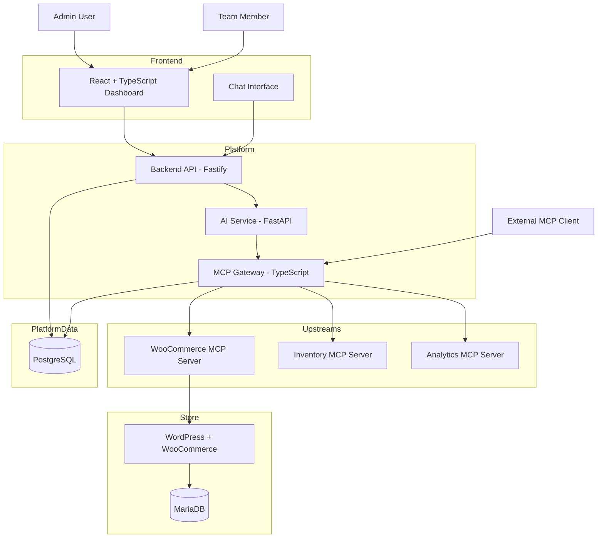

# Architecture — Team MCP Gateway on Kubernetes

## 1. Project Overview

The goal is to build a team-based MCP (Model Context Protocol) gateway platform for WooCommerce and other MCP-compatible services.

The platform allows teams to register MCP servers behind a single gateway endpoint. Administrators can manage upstream servers, team members, API keys, and tool permissions. Members can interact with authorized tools through an AI chat interface or external MCP clients.

The platform must run locally on Kubernetes using **Kind** and be deployable to a production-like VPS using **k3s**, with the same Helm charts and environment-specific configuration.

### Core objectives

- Host a working WooCommerce store.
- Implement a custom WooCommerce MCP server.
- Connect at least three upstream MCP servers.
- Expose one unified MCP gateway endpoint.
- Provide separate admin and member experiences.
- Enforce authentication and tool-level authorization.
- Support AI-powered tool calling through the gateway.
- Maintain auditable records of tool invocations.
- Isolate upstream failures so one unavailable service does not bring down the entire platform.
- Deploy the system through Docker, Kubernetes, and Helm.

## 2. High-Level Architecture

The platform is divided into six logical layers:

1. Frontend dashboard and chat interface.
2. Backend API for users, teams, server management, and chat orchestration.
3. MCP Gateway for authentication, authorization, tool discovery, and routing.
4. AI service for LLM-powered conversations and tool selection.
5. Upstream MCP servers, including WooCommerce, Inventory, and Analytics.
6. Persistent databases and Kubernetes infrastructure.

### Architecture diagram

**Important boundary:** The AI service and external MCP clients must access upstream tools through the MCP Gateway. They must not connect directly to upstream MCP servers to execute tools.

## 3. Components and Responsibilities

### 3.1 Frontend Dashboard

**Technology:** React, TypeScript, Vite.

The frontend provides the interface for administrators and team members.

#### Admin capabilities

- View platform overview and service health.
- Register, configure, disable, enable, and remove upstream MCP servers.
- Inspect discovered tools for each server.
- Manage team members and invitations.
- Issue and revoke API keys.
- Configure tool permissions.
- Inspect audit logs and tool invocation outcomes.
- Access the AI chat interface.

#### Member capabilities

- View the unified gateway endpoint.
- Generate and revoke their own API keys.
- View tools they are authorized to use.
- Use the AI chat interface.
- View their own activity and tool invocation history.
- Connect external MCP clients using their gateway endpoint and API key.

The frontend is not a security boundary. Hiding a button or tool in the UI does not enforce authorization. The backend and gateway must independently validate every protected operation.

### 3.2 Backend API

**Technology:** Node.js, TypeScript, Fastify.

The backend manages platform operations and acts as the main API for the dashboard.

Responsibilities:

- User authentication and session management.
- Admin/member role enforcement for dashboard APIs.
- Team invitations and member management.
- API key creation, listing, and revocation.
- Upstream server registration and configuration.
- Permission policy management.
- Chat conversation management.
- Communication with the AI service.
- Dashboard summary data and audit log queries.

The backend and gateway can use the same PostgreSQL database while maintaining separate modules and restricted database access.

The backend does not replace gateway authorization. A user invoking a tool through chat or an external MCP client must still be authorized by the gateway.

### 3.3 MCP Gateway

**Technology:** Node.js, TypeScript, official MCP SDK.

The gateway is the central entry point for MCP clients and the most important security boundary in the system.

It exposes one stable MCP endpoint and connects to registered upstream MCP servers as an MCP client.

Responsibilities:

- Authenticate incoming MCP requests.
- Resolve the requesting user and their identity.
- Validate API keys and revocation status.
- Enforce user- and role-based tool permissions.
- Discover tools from upstream MCP servers.
- Aggregate tools into a unified tool list.
- Namespace tool names when required.
- Route tool calls to the correct upstream server.
- Apply timeouts and handle upstream errors.
- Prevent one failed upstream from disrupting healthy upstreams.
- Record audit events for tool invocations.
- Exclude disabled servers and tools from discovery.
- Ensure that authorization is checked again when a tool is invoked.

#### Unified tool naming

Tool names may collide across upstream servers. The gateway must expose unique names.

Examples:

- `woocommerce__list_products`
- `woocommerce__list_orders`
- `inventory__list_stock`
- `analytics__get_daily_sales`

The gateway maintains a mapping between each exposed tool name and its original upstream server and tool name.

The gateway must not assume that a tool is safe merely because it was discovered or shown to a user.

### 3.4 AI Service

**Technology:** Python, FastAPI, hosted LLM with tool-calling support.

The AI service powers the conversational interface. It is responsible for deciding when a tool should be called and presenting results to the user.

Responsibilities:

- Accept chat requests from the backend.
- Maintain the conversation context supplied by the platform.
- Construct prompts and tool descriptions.
- Call the selected hosted LLM.
- Interpret tool-call requests returned by the model.
- Invoke the requested tools through the MCP Gateway.
- Return tool results to the model when another reasoning step is needed.
- Continue the tool-calling loop until a final response is produced or a safe limit is reached.
- Return a readable response to the backend.

The AI service is not the authority for access control. It must not grant permissions, bypass the gateway, or use upstream credentials directly.

The hosted LLM provider will be selected later. The service should isolate provider-specific logic behind a small interface so that the provider can be changed without redesigning the gateway.

### 3.5 WooCommerce MCP Server

**Technology:** Python with FastMCP, using Streamable HTTP transport.

This is a custom MCP server implemented for the assignment.

It exposes WooCommerce operations as MCP tools and communicates with WooCommerce through its REST API.

Initial tool scope:

- List products.
- Create a product.
- List orders.
- Get an order.
- Update an order's status.

The WooCommerce MCP server stores or receives its WooCommerce credentials through server-side secret configuration. These credentials must never be exposed to the frontend, AI model, or external MCP clients.

The MCP server is responsible for translating tool inputs into valid WooCommerce API requests and returning structured results or meaningful errors.

### 3.6 Inventory MCP Server

A second, lightweight MCP server that exposes inventory-related functionality.

Proposed capabilities:

- List stock items.
- Get stock for a product or SKU.
- Find low-stock items.
- Retrieve stock information for a warehouse.

This server will be implemented as a separate service so that it can be independently deployed, tested, and stopped during failure-isolation demonstrations.

### 3.7 Analytics MCP Server

A third MCP server that exposes sales and product analytics.

Proposed capabilities:

- Retrieve daily sales summaries.
- Retrieve product performance metrics.
- Query order and revenue aggregates.
- Compare sales across dates or products.

The implementation can begin with deterministic synthetic data. It should remain independent of the gateway so that the platform can demonstrate aggregation across multiple upstream servers.

The exact tools and data contracts for the Inventory and Analytics servers will be finalized during implementation.

## 4. Data Storage Architecture

The platform uses two separate database systems for different responsibilities.

### 4.1 PostgreSQL — Platform Metadata

PostgreSQL stores the gateway platform's own data:

- Users and roles.
- API key hashes and metadata.
- Registered MCP servers.
- Cached tool metadata.
- Tool permission policies.
- Invitations.
- Audit logs.
- Chat conversations and messages.

The backend and gateway use PostgreSQL for their respective platform operations, with access restricted according to each service's responsibilities.

### 4.2 MariaDB — WooCommerce Data

MariaDB stores WordPress and WooCommerce application data.

It is used for:

- Products.
- Customers.
- Orders.
- Order items.
- WooCommerce configuration and related WordPress records.

The platform must not duplicate the WooCommerce product and order database in PostgreSQL. The WooCommerce MCP server accesses those records through the WooCommerce REST API.

### 4.3 Persistence and networking

Both databases run inside the local Kubernetes environment with persistent volume claims (PVCs).

- PostgreSQL and MariaDB use Kubernetes Services for internal connectivity.
- Database services are not exposed directly to the public internet.
- Persistent storage must survive ordinary pod restarts.
- Database credentials are supplied through Kubernetes Secrets or equivalent protected deployment configuration.

The production-like deployment must also provide persistent storage appropriate to the VPS environment.

## 5. Authentication and Authorization

Security must be enforced at the backend and gateway rather than relying on frontend controls.

### 5.1 User roles

Two initial roles are required:

**Admin**

- Manage registered MCP servers.
- Manage team members and invitations.
- Issue or revoke keys for team members where permitted by the platform policy.
- Configure tool permissions.
- View platform-wide audit logs.
- Access administrative APIs.

**Member**

- Access authorized dashboard functionality.
- Generate and revoke their own API keys.
- Use permitted tools through chat or external MCP clients.
- View their own activity.
- Cannot administer upstream servers or change platform-wide permissions.

### 5.2 API key lifecycle

- Generate a cryptographically random API key.
- Show the plaintext key only when it is created.
- Store a hash of the key, not the plaintext value.
- Associate the key with a user and metadata such as creation, expiry, and revocation.
- Validate the key on each authenticated gateway request.
- Reject expired or revoked keys.
- Never write plaintext keys into logs.

An administrator's key-management permissions and a member's self-service key permissions must be enforced by the backend API.

### 5.3 Tool authorization

Every tool invocation must pass a gateway authorization check.

The gateway must verify:

1. The caller is authenticated.
2. The caller's key is valid and not revoked.
3. The caller is permitted to invoke the requested tool.
4. The target server is enabled and available for routing.
5. The tool remains registered and enabled.

A tool hidden in the UI must still be rejected if a caller invokes it directly without permission.

The permission system will support role-level defaults and user-specific rules. The exact precedence and conflict-resolution rules will be defined in `data_schema.md` and implemented consistently in the gateway.

### 5.4 Internal chat identity

For chat requests, the backend must provide a verifiable user identity to the gateway through a trusted server-to-server mechanism.

The gateway must not blindly trust a user ID supplied by the browser, a chat message, or the LLM. The internal identity mechanism must prevent callers from impersonating another team member.

External MCP clients authenticate using their own API keys.

Both access paths must reach the same gateway authorization and auditing logic.

### 5.5 Upstream credentials and endpoint safety

- Upstream credentials remain server-side.
- Store references to credentials rather than plaintext credentials in ordinary platform records.
- Protect actual credentials using Kubernetes Secrets or an equivalent secure mechanism.
- Do not expose upstream credentials through tool descriptions, chat responses, API responses, or audit logs.
- Validate administrator-supplied upstream URLs.
- Block requests to prohibited internal, loopback, link-local, or cloud metadata destinations as appropriate.
- Revalidate destinations and resolved addresses to reduce server-side request forgery (SSRF) risks.
- Apply timeouts to upstream connections.

## 6. Main Request Flows

### 6.1 Admin registers an upstream server

1. The admin signs in to the dashboard.
2. The frontend sends a registration request to the backend API.
3. The backend verifies the user's admin role and validates the submitted configuration.
4. The server configuration and protected credential reference are stored.
5. The gateway connects to the upstream MCP server and discovers its tools.
6. The gateway stores or refreshes tool metadata.
7. The dashboard displays the server status and discovered tools.

Registration must not expose upstream credentials to the browser after submission.

### 6.2 Member uses the AI chat

1. The member sends a message through the dashboard.
2. The frontend submits the message to the backend API.
3. The backend authenticates the member and forwards the request to the AI service.
4. The AI service supplies the available tool descriptions and conversation context to the hosted LLM.
5. The LLM requests a tool call when needed.
6. The AI service invokes the MCP Gateway rather than contacting an upstream server directly.
7. The gateway authenticates the request, checks permissions, and routes the call to the correct upstream.
8. The upstream returns a result.
9. The gateway records the invocation outcome.
10. The AI service returns the tool result to the LLM for further processing if required.
11. The AI service returns the final response to the backend.
12. The frontend displays the answer and, where appropriate, a readable tool trace.

Tool execution must not bypass the gateway just because the request originated from the platform's own chat interface.

### 6.3 External MCP client invokes a tool

1. A member configures an external MCP client with the gateway endpoint and their API key.
2. The client connects to the unified gateway endpoint.
3. The gateway authenticates the API key.
4. The client discovers the tools available through the gateway.
5. When a tool is invoked, the gateway checks current permissions and server status.
6. The gateway routes the invocation to the upstream MCP server.
7. The gateway returns the result and records an audit event.

The external client must not need individual upstream URLs or upstream credentials.

### 6.4 Cross-server operation

A workflow may require information from multiple upstream servers.

For example, the AI service may retrieve today's WooCommerce orders and query Analytics for daily sales totals, or retrieve a product's stock from Inventory after finding the product in WooCommerce.

Each tool invocation goes through the same gateway. Each invocation is authorized and audited independently.

Cross-server orchestration must not give the AI service direct access to upstream credentials or endpoints.

### 6.5 API key revocation

1. A user or authorized admin revokes an API key.
2. The backend records the revocation.
3. Subsequent requests authenticated with that key are rejected by the gateway.
4. The rejection is recorded without logging the plaintext key.

Revocation should take effect promptly; the design must not rely on a long-lived cached authentication result without invalidation.

### 6.6 Disabling an upstream server

1. An admin disables a registered server.
2. The gateway updates the server's enabled state.
3. Its tools are excluded from subsequent discovery results.
4. Calls targeting those tools are rejected rather than routed.
5. The dashboard reflects the disabled state.
6. The change and relevant subsequent outcomes are auditable.

Disabling a server must not affect calls to other healthy upstream servers.

## 7. Unified MCP Gateway Design

The gateway is responsible for presenting one stable interface over multiple independent MCP servers.

### Tool discovery

- Connect to enabled upstream servers.
- Discover their tools and input schemas.
- Cache metadata for dashboard display and gateway discovery.
- Refresh metadata when a server is registered, enabled, reconfigured, or explicitly refreshed.
- Remove disabled-server tools from the exposed tool list.
- Handle an unreachable upstream without preventing healthy servers from contributing their tools.

The gateway must define a clear freshness and error policy for cached tool metadata. Cached metadata must not be treated as permission to invoke a disabled server or tool.

### Tool routing

For each exposed tool, maintain a mapping containing:

- Upstream server identity.
- Original tool name.
- Exposed tool name.
- Input schema.
- Enabled state.

The gateway uses this mapping to route a call to the correct upstream.

### Timeouts and failure isolation

- Apply configurable request timeouts.
- Return structured, understandable errors for failed upstream calls.
- Record failures and duration in the audit log.
- Prevent one upstream failure from crashing the gateway or blocking unrelated tools indefinitely.
- Keep health checks and request execution failures distinguishable.
- Avoid retrying non-idempotent operations automatically unless retry safety is explicitly established.

### Stable public endpoint

The gateway is exposed through a stable URL routed by Kubernetes Ingress. Internal upstream service addresses remain private and can change without requiring external clients to reconfigure their tools.

## 8. Audit Logging and Observability

Every tool invocation must produce an audit record, including denied calls and failed invocations where applicable.

Expected fields include:

- Requesting user or actor.
- Upstream server.
- Tool name.
- Timestamp.
- Duration.
- Outcome.
- Error code or failure category, when applicable.

Audit logs must distinguish the initiating user even when the invocation passes through the backend and AI service.

Do not log API keys, upstream secrets, passwords, or unnecessary sensitive payloads. Store only the operational details needed for auditing and troubleshooting.

The platform should expose:

- Server health and last-check time.
- Upstream connectivity and tool-discovery status.
- Request outcomes and latency.
- Clear errors in dashboard and chat.
- Kubernetes pod readiness and liveness status.

## 9. Kubernetes and Deployment Architecture

### 9.1 Local development

**Local environment: Docker + Kind + Kubernetes + Helm.**

Kind creates a local Kubernetes cluster using Docker containers as Kubernetes nodes. Application services are built as Docker images, made available to the Kind cluster, and deployed using Helm.

The local cluster contains the application services, platform database, WooCommerce stack, and upstream MCP servers.

### 9.2 Production-like environment

The target deployment is a VPS running k3s.

The same Helm charts should be reused, with environment-specific values for items such as:

- Image references and tags.
- Hostnames and Ingress configuration.
- Resource requests and limits.
- Storage configuration.
- Secret references.
- Service endpoints and environment variables.

Local and VPS deployments must not require separate application architectures.

### 9.3 Kubernetes resources

The deployment will use the appropriate Kubernetes resources for each service:

- **Deployments** for stateless application services.
- **Services** for stable internal network endpoints.
- **PersistentVolumeClaims** for persistent database storage.
- **Ingress** for stable external access.
- **Secrets** for sensitive configuration.
- **ConfigMaps** for non-sensitive configuration.
- **Readiness and liveness probes** for application health.
- **Resource requests and limits** for workloads.

The exact resource definitions and values will be specified in Helm charts and deployment documentation.

### 9.4 Network exposure

Only required public entry points should be exposed, such as the dashboard, gateway, and WooCommerce storefront.

PostgreSQL, MariaDB, and upstream MCP servers should remain on internal Kubernetes networking unless a specific deployment requirement justifies additional exposure.

### 9.5 Persistence and recovery

Database pods must use persistent storage so ordinary pod recreation does not erase platform metadata or WooCommerce data.

The application should tolerate restarts and recover connections when database or upstream pods return. Persistent volumes are not a substitute for backups; backup and restore procedures should be documented for the VPS deployment.

## 10. Initial Service Inventory

| Service | Technology | Responsibility |
|---|---|---|
| Frontend | React, TypeScript, Vite | Admin/member dashboard and chat UI |
| Backend API | Node.js, TypeScript, Fastify | Authentication, team, server management, chat orchestration |
| MCP Gateway | Node.js, TypeScript, MCP SDK | Unified MCP endpoint, authorization, discovery, routing, auditing |
| AI Service | Python, FastAPI | LLM interaction and tool-calling loop |
| WooCommerce MCP | Python, FastMCP | Product and order operations |
| Inventory MCP | Python or another selected implementation | Stock and warehouse tools |
| Analytics MCP | Python or another selected implementation | Sales aggregates and product analytics |
| WordPress/WooCommerce | WordPress + WooCommerce | Storefront and commerce application |
| Platform Database | PostgreSQL | Platform metadata and audit data |
| Store Database | MariaDB | WordPress and WooCommerce persistence |
| Local Cluster | Kind | Local Kubernetes development |
| VPS Cluster | k3s | Production-like Kubernetes deployment |
| Packaging | Docker and Helm | Containerization and repeatable deployment |

## 11. Scope and Implementation Order

The initial implementation should prioritize a working, secure end-to-end system.

### Phase 1 — Foundation

- Set up repository structure.
- Create the Kind cluster.
- Establish Helm chart structure.
- Deploy PostgreSQL, MariaDB, and WordPress/WooCommerce.
- Configure persistent volumes and Ingress.

### Phase 2 — MCP connectivity

- Implement the custom WooCommerce MCP server.
- Implement Inventory and Analytics MCP servers.
- Build the gateway and its upstream connection management.
- Implement unified tool discovery and routing.

### Phase 3 — Identity and security

- Implement user authentication and roles.
- Implement API key creation, hashing, validation, and revocation.
- Implement tool permission policies.
- Add upstream credential protection and URL validation.
- Enforce gateway-side authorization.

### Phase 4 — Dashboard and AI

- Implement admin and member dashboard screens.
- Add server management, tool permissions, team, and audit views.
- Implement the Python AI service and hosted LLM tool-calling loop.
- Connect the chat flow exclusively through the gateway.

### Phase 5 — Validation

- Test chat-based product creation and order queries.
- Test external MCP client access.
- Test permissions, revocation, and server disablement.
- Test cross-server workflows and upstream failure isolation.
- Verify persistent storage and clean Helm installation.
- Deploy to a VPS using the same charts and environment-specific values.

### Phase 6 — Documentation and demo

- Document architecture and security decisions.
- Document local and VPS setup.
- Add deterministic mock data and repeatable seed scripts.
- Prepare a demonstration covering the assignment's required scenarios.

## 12. Non-Goals for the Initial Version

To keep the implementation manageable, the following are deferred until the core requirements work:

- Multi-store provisioning.
- OAuth-based external authentication.
- Complex enterprise policy management.
- Multiple gateway replicas and advanced high availability.
- A separate Redis deployment.
- Advanced autoscaling and large-scale performance optimization.

These can be reconsidered after the required functionality, security checks, tests, and deployments are working.

## 13. Architecture Invariants

The following rules must remain true throughout implementation:

1. The gateway is the only tool-execution path for chat and external MCP clients.
2. The gateway enforces authorization on every tool invocation.
3. Upstream credentials are never exposed to users or the LLM.
4. API keys are stored as hashes and revocation is enforced.
5. Disabled servers cannot be invoked, even if their tools remain in stale client metadata.
6. A failed upstream must not take down unrelated healthy upstreams.
7. Every tool invocation is auditable and attributed to the initiating user where identity is available.
8. Platform metadata and WooCommerce application data remain in their respective databases.
9. Kind is used for local Kubernetes development; the same Helm charts are used for the k3s deployment.
10. Secrets are not hardcoded into source code, Docker images, or committed configuration.
