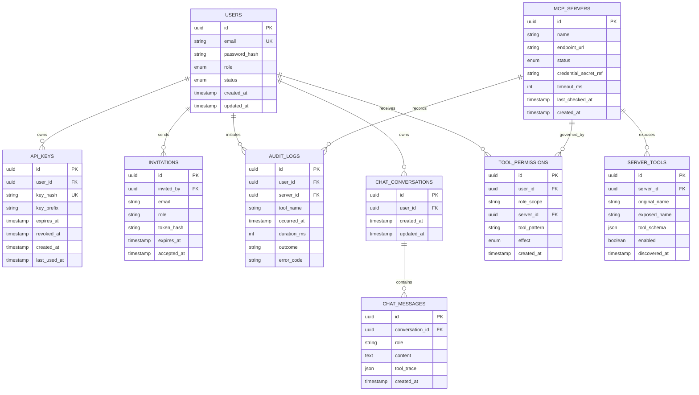

# Data Schema — Team MCP Gateway on Kubernetes

## 1. Purpose

This document defines the platform's data model and mock-data strategy for the Team MCP Gateway.

The database design must support:

- User authentication and admin/member roles.
- API key generation, validation, expiry, and revocation.
- Registration and lifecycle management of upstream MCP servers.
- Discovery and aggregation of MCP tools.
- Role-based and user-specific tool permissions.
- Audit logging for tool invocations.
- Team invitations.
- AI chat conversations and tool traces.
- Deterministic mock data for development and testing.

## 2. Database Architecture

The application uses two separate databases.

| Database | Responsibility |
|---|---|
| PostgreSQL | Platform metadata, identity, permissions, audit logs, and chat records |
| MariaDB | WordPress and WooCommerce application data |

### PostgreSQL

The backend API and MCP Gateway use PostgreSQL for their respective platform operations. They may share the same database initially, but their application modules and database permissions should remain separated.

Prisma is the proposed ORM for TypeScript database access and migrations.

### MariaDB

MariaDB stores WooCommerce products, customers, orders, order items, and related WordPress records.

The custom WooCommerce MCP server interacts with the store through the WooCommerce REST API. The platform must not create duplicate authoritative product and order tables in PostgreSQL.

## 3. Entity Relationship Diagram



The diagram is a logical model. The exact PostgreSQL types, constraints, indexes, and delete behavior should be implemented through the Prisma schema and migrations.

## 4. Schema Conventions

Use the following conventions across platform tables:

- UUID primary keys.
- UTC timestamps stored using PostgreSQL `TIMESTAMPTZ`.
- `created_at` and `updated_at` where appropriate.
- Foreign keys for relationships.
- Unique constraints for identifiers such as email and key hash.
- Explicit status and outcome values.
- JSONB for flexible tool schemas and structured traces.
- Indexes for frequently queried fields.
- No plaintext API keys, passwords, or upstream credentials in ordinary tables.

Prefer explicit enums or constrained values for roles, statuses, and outcomes.

## 5. Table Definitions

### 5.1 `users`

Stores platform user accounts.

| Column | Type | Constraints | Description |
|---|---|---|---|
| `id` | UUID | Primary key | User identifier |
| `email` | VARCHAR(255) | Unique, not null | Login email |
| `password_hash` | TEXT | Not null | Password hash produced by an established password-hashing library |
| `role` | ENUM | Not null | `ADMIN` or `MEMBER` |
| `status` | ENUM | Not null | `ACTIVE`, `INVITED`, or `DISABLED` |
| `created_at` | TIMESTAMPTZ | Not null | Creation timestamp |
| `updated_at` | TIMESTAMPTZ | Not null | Last update timestamp |

Rules:

- Normalize email addresses before enforcing uniqueness.
- Never store plaintext passwords.
- Only active users can authenticate.
- Role changes must be enforced by backend authorization checks.
- Disabled users must not retain effective access through previously issued API keys.

### 5.2 `api_keys`

Stores metadata for keys used by external MCP clients and other authorized gateway clients.

| Column | Type | Constraints | Description |
|---|---|---|---|
| `id` | UUID | Primary key | Key record identifier |
| `user_id` | UUID | FK to `users.id`, not null | Key owner |
| `name` | VARCHAR(100) | Optional | User-defined key label |
| `key_hash` | TEXT | Unique, not null | Hash used for key validation |
| `key_prefix` | VARCHAR(20) | Not null | Non-secret prefix for identification |
| `expires_at` | TIMESTAMPTZ | Nullable | Expiration time |
| `revoked_at` | TIMESTAMPTZ | Nullable | Revocation time |
| `created_at` | TIMESTAMPTZ | Not null | Creation timestamp |
| `last_used_at` | TIMESTAMPTZ | Nullable | Most recent successful use |

Rules:

- Generate keys using a cryptographically secure random generator.
- Show the complete plaintext key only at creation.
- Store only a suitable cryptographic hash or keyed digest.
- Never use the prefix as an authentication credential.
- Reject expired, revoked, or otherwise invalid keys.
- Update `last_used_at` after successful authentication.
- Revoke keys through a controlled backend operation.

The gateway must not depend on a long-lived authentication cache that allows a revoked key to continue working.

### 5.3 `mcp_servers`

Stores the registry of upstream MCP servers.

| Column | Type | Constraints | Description |
|---|---|---|---|
| `id` | UUID | Primary key | Server identifier |
| `name` | VARCHAR(100) | Unique, not null | Human-readable server name |
| `endpoint_url` | TEXT | Not null | Validated upstream MCP endpoint |
| `status` | ENUM | Not null | `ENABLED`, `DISABLED`, or `UNHEALTHY` |
| `credential_secret_ref` | TEXT | Nullable | Reference to protected upstream credentials |
| `timeout_ms` | INTEGER | Not null | Per-request timeout |
| `last_checked_at` | TIMESTAMPTZ | Nullable | Last health or connectivity check |
| `created_at` | TIMESTAMPTZ | Not null | Registration timestamp |
| `updated_at` | TIMESTAMPTZ | Not null | Last configuration change |

Rules:

- Store credential references, not raw upstream secrets.
- Validate endpoint URLs before registration and before making connections.
- Apply an explicit timeout limit.
- `DISABLED` means the server must not be exposed for discovery or invocation.
- `UNHEALTHY` represents an operational failure; it does not automatically mean an administrator disabled the server.
- A health check must not be the sole authorization check for an actual invocation.

The implementation may separate administrative enablement from health status into two columns if that produces clearer state management.

### 5.4 `server_tools`

Stores discovered tool metadata for registered MCP servers.

| Column | Type | Constraints | Description |
|---|---|---|---|
| `id` | UUID | Primary key | Tool record identifier |
| `server_id` | UUID | FK to `mcp_servers.id`, not null | Owning server |
| `original_name` | VARCHAR(255) | Not null | Tool name exposed by the upstream |
| `exposed_name` | VARCHAR(255) | Unique, not null | Name exposed by the gateway |
| `description` | TEXT | Nullable | Tool description |
| `tool_schema` | JSONB | Not null | Input schema and relevant metadata |
| `enabled` | BOOLEAN | Not null | Whether the tool is enabled in the registry |
| `discovered_at` | TIMESTAMPTZ | Not null | Most recent successful discovery timestamp |

Constraints:

- Unique constraint on `(server_id, original_name)`.
- Unique constraint on `exposed_name`.
- Index on `server_id`.
- Index on `enabled`.

Example records:

| Server | Original tool | Exposed tool |
|---|---|---|
| WooCommerce | `list_products` | `woocommerce__list_products` |
| WooCommerce | `list_orders` | `woocommerce__list_orders` |
| Inventory | `list_stock` | `inventory__list_stock` |
| Analytics | `get_daily_sales` | `analytics__get_daily_sales` |

The gateway must exclude tools belonging to disabled servers. Cached metadata must never override current server state or tool permissions.

### 5.5 `tool_permissions`

Stores role-level defaults and user-specific tool permissions.

| Column | Type | Constraints | Description |
|---|---|---|---|
| `id` | UUID | Primary key | Permission identifier |
| `user_id` | UUID | Nullable FK to `users.id` | Target user for an individual rule |
| `role_scope` | ENUM | Nullable | `ADMIN` or `MEMBER` for a role-level rule |
| `server_id` | UUID | Nullable FK to `mcp_servers.id` | Optional server restriction |
| `tool_pattern` | VARCHAR(255) | Not null | Exact tool name or supported wildcard pattern |
| `effect` | ENUM | Not null | `ALLOW` or `DENY` |
| `created_at` | TIMESTAMPTZ | Not null | Creation timestamp |
| `updated_at` | TIMESTAMPTZ | Not null | Last update timestamp |

#### Target constraints

Each permission must target either:

- A single user (`user_id` is set and `role_scope` is null), or
- A role (`role_scope` is set and `user_id` is null).

Enforce this using a database `CHECK` constraint.

Also define uniqueness rules that prevent duplicate rules for the same target, server scope, and tool pattern. PostgreSQL partial unique indexes may be needed for nullable target columns.

#### Permission matching

A permission may be scoped to:

- One exact tool.
- All tools from a particular server.
- A supported wildcard pattern.
- All servers, when `server_id` is null.

Keep wildcard syntax deliberately limited and documented. Avoid implementing a complicated policy language for the first version.

#### Permission evaluation

Use the following initial policy:

1. Authenticate the caller and verify the associated user is active.
2. Confirm the API key is valid if API key authentication is used.
3. Reject calls to disabled servers or disabled tools.
4. Collect matching role-level and user-specific permission rules.
5. If any applicable rule is `DENY`, deny the call.
6. Otherwise, if at least one applicable rule is `ALLOW`, allow the call.
7. If no applicable rule allows the call, deny by default.

This makes explicit denials override allows and avoids granting access merely because a rule is missing.

Admin role alone should not bypass server state, authentication, or the explicit security rules. If administrators require an emergency override capability, define and audit it separately rather than implicitly bypassing authorization.

All invocation paths, including chat and external MCP clients, must use this same policy evaluation logic.

### 5.6 `audit_logs`

Stores records of tool invocations and relevant authorization outcomes.

| Column | Type | Constraints | Description |
|---|---|---|---|
| `id` | UUID | Primary key | Audit record identifier |
| `user_id` | UUID | Nullable FK to `users.id` | Initiating user, if resolved |
| `server_id` | UUID | Nullable FK to `mcp_servers.id` | Target upstream server |
| `tool_name` | VARCHAR(255) | Not null | Exposed tool name or attempted tool name |
| `occurred_at` | TIMESTAMPTZ | Not null | Event timestamp |
| `duration_ms` | INTEGER | Nullable | Invocation duration |
| `outcome` | ENUM | Not null | `SUCCESS`, `DENIED`, or `ERROR` |
| `error_code` | VARCHAR(100) | Nullable | Sanitized failure category |
| `request_id` | UUID | Nullable | Correlation identifier |
| `actor_type` | ENUM | Not null | `API_KEY`, `CHAT`, or `INTERNAL` |

Rules:

- Record successful invocations.
- Record permission-denied attempts where the attempted tool can be identified.
- Record upstream errors and timeouts.
- Attribute calls to the actual initiating user, not just the backend or AI service.
- Use nullable foreign keys or retained actor/server snapshots where audit history must survive account or server deletion.
- Avoid cascading deletes that erase audit history.
- Never log plaintext keys, passwords, upstream credentials, or sensitive raw payloads.

Recommended indexes:

- `(occurred_at DESC)`
- `(user_id, occurred_at DESC)`
- `(server_id, occurred_at DESC)`
- `(tool_name, occurred_at DESC)`
- `(outcome, occurred_at DESC)`

For the initial assignment, PostgreSQL is sufficient. Partitioning can be considered if audit volume grows substantially.

### 5.7 `invitations`

Stores team invitations.

| Column | Type | Constraints | Description |
|---|---|---|---|
| `id` | UUID | Primary key | Invitation identifier |
| `invited_by` | UUID | FK to `users.id`, not null | Inviting administrator |
| `email` | VARCHAR(255) | Not null | Invitee email |
| `role` | ENUM | Not null | Intended role |
| `token_hash` | TEXT | Unique, not null | Hashed invitation token |
| `expires_at` | TIMESTAMPTZ | Not null | Expiration timestamp |
| `accepted_at` | TIMESTAMPTZ | Nullable | Acceptance timestamp |
| `created_at` | TIMESTAMPTZ | Not null | Creation timestamp |

Rules:

- Only authorized administrators can issue invitations.
- Store only a hash of the invitation token.
- Reject expired or already accepted invitations.
- Normalize email addresses.
- Apply rate limits to invitation creation and acceptance.
- Invitation acceptance must not allow the invitee to choose a more privileged role.

### 5.8 `chat_conversations`

Stores conversation metadata.

| Column | Type | Constraints | Description |
|---|---|---|---|
| `id` | UUID | Primary key | Conversation identifier |
| `user_id` | UUID | FK to `users.id`, not null | Conversation owner |
| `title` | VARCHAR(255) | Nullable | Optional conversation title |
| `created_at` | TIMESTAMPTZ | Not null | Creation timestamp |
| `updated_at` | TIMESTAMPTZ | Not null | Last update timestamp |

Rules:

- Members may access only their own conversations.
- Administrators should not automatically receive access to every message merely because they have the admin role.
- Define retention and deletion policies for conversation content.

### 5.9 `chat_messages`

Stores chat messages and relevant tool traces.

| Column | Type | Constraints | Description |
|---|---|---|---|
| `id` | UUID | Primary key | Message identifier |
| `conversation_id` | UUID | FK to `chat_conversations.id`, not null | Parent conversation |
| `role` | ENUM | Not null | `USER`, `ASSISTANT`, or `TOOL` |
| `content` | TEXT | Not null | Message content |
| `tool_trace` | JSONB | Nullable | Sanitized tool-call metadata |
| `created_at` | TIMESTAMPTZ | Not null | Message timestamp |

The tool trace may contain:

- Exposed tool name.
- Invocation status.
- Request or correlation identifier.
- A sanitized summary of the result.
- Duration.

Do not store upstream credentials or unnecessary sensitive order/customer data in traces.

If full tool-call arguments or results are needed for debugging, use a separate explicit retention and redaction policy.

## 6. Relationships and Deletion Rules

Recommended relationship behavior:

- Deleting a user should not erase historical audit records.
- Revoking an API key should update its state rather than immediately deleting the record.
- Disabling a server should preserve its registration and tool history.
- Removing a server should not erase existing audit history.
- Deleting a conversation may delete its messages if that is the defined retention policy.
- Accepted or expired invitations can be retained for a limited period for operational auditing.

Use restrictive foreign keys or soft deletion where historical traceability is important. Do not use cascading deletion indiscriminately.

## 7. Index and Constraint Summary

Create indexes and constraints for the most common operations.

| Table | Indexes / constraints |
|---|---|
| `users` | Unique normalized email; status and role where useful |
| `api_keys` | Unique key hash; index on user ID; expiry/revocation lookup as needed |
| `mcp_servers` | Unique server name; index on status |
| `server_tools` | Unique exposed name; unique `(server_id, original_name)`; index on server and enabled state |
| `tool_permissions` | Target and scope indexes; uniqueness for applicable rule dimensions |
| `audit_logs` | Timestamp, user, server, tool, outcome indexes |
| `invitations` | Unique token hash; email and expiry indexes |
| `chat_conversations` | Index on `(user_id, updated_at DESC)` |
| `chat_messages` | Index on `(conversation_id, created_at)` |

Avoid adding indexes without a query or integrity requirement. Review actual query plans if the dataset grows.

## 8. Mock Data Strategy

Mock data must make the required assignment demonstrations repeatable.

Keep platform seed data separate from test fixtures. Use deterministic IDs or stable natural identifiers wherever practical, and make seed scripts idempotent.

Do not use real customer information, production credentials, or real API keys in mock data.

### 8.1 Platform seed data

Recommended initial seed targets:

| Entity | Target quantity | Purpose |
|---|---:|---|
| Users | 2–10 | Admin/member role demonstrations |
| API key records | 5–20 | Valid, revoked, and expired key scenarios |
| MCP servers | At least 3 | WooCommerce, Inventory, Analytics |
| Discovered tools | 15–30 | Tool aggregation and permission testing |
| Permission rules | 20–50 | Allow, deny, role, and user-specific cases |
| Audit events | 200–500 | Filters, pagination, and analytics |
| Conversations | 10–30 | Chat history |
| Messages | 50–150 | Conversation history and tool traces |
| Invitations | 5–10 | Pending, accepted, and expired cases |

These quantities are development targets, not production requirements.

### 8.2 User fixtures

Create at least:

- One active administrator.
- One active member.
- One additional member for cross-user isolation tests.
- One disabled user for authentication tests, if needed.

Use development-only passwords and seed them through the normal password-hashing function. Do not hardcode production passwords.

Example fixture labels:

```text
admin@example.test
member-a@example.test
member-b@example.test
```

These are synthetic example addresses and must not be treated as real accounts.

### 8.3 API key fixtures

Cover:

- Active, unexpired key.
- Revoked key.
- Expired key.
- Key belonging to a disabled user.
- Multiple keys belonging to one user.

For security, test helpers should generate keys and insert their hashes. Do not create seed records with known production-like plaintext keys.

### 8.4 MCP server fixtures

Create these three logical server registrations:

| Server name | Purpose | Initial state |
|---|---|---|
| `woocommerce` | Products and orders | Enabled |
| `inventory` | Stock and warehouse queries | Enabled |
| `analytics` | Sales and product metrics | Enabled |

For operational tests, create additional isolated fixtures for disabled and unhealthy server states. The primary demo environment should have all three required servers registered.

### 8.5 Tool fixtures

Use the actual tool names and schemas discovered from the running MCP servers whenever possible.

Illustrative names:

```text
woocommerce__list_products
woocommerce__create_product
woocommerce__list_orders
woocommerce__get_order
woocommerce__update_order_status

inventory__list_stock
inventory__get_stock
inventory__find_low_stock

analytics__get_daily_sales
analytics__get_product_performance
```

Do not rely on fabricated cached schemas as the only test of live discovery. Include integration tests against the actual MCP servers.

### 8.6 Permission fixtures

Create examples covering:

- Member allowed to list products.
- Member allowed to list orders.
- Member denied product creation.
- Member denied order-status updates.
- A role-level allow.
- A user-specific deny overriding an applicable allow.
- A user-specific allow when no deny applies.
- No matching rule, which must be denied by default.
- Admin management of server configuration.
- A disabled server whose tools must remain unavailable regardless of user permissions.

These fixtures must test both UI visibility and direct invocation through the gateway. Direct invocation is the authoritative authorization test.

## 9. WooCommerce Mock Data

Seed WooCommerce through its supported API or normal application-level import process.

Do not insert products or orders directly into WooCommerce's internal MariaDB tables.

### Recommended quantities

| Entity | Target quantity |
|---|---:|
| Products | 50–100 |
| Synthetic customers | 30–50 |
| Orders | 100–200 |
| Product categories | 5–10 |

Ensure the seeded order data includes multiple line items, prices, dates, and statuses.

### Product scenarios

Include:

- In-stock products.
- Low-stock products.
- Out-of-stock products.
- Products with different prices.
- Products with categories.
- Products with optional descriptions or metadata.

### Order scenarios

Include:

- Processing orders.
- Completed orders.
- Pending orders.
- Cancelled orders.
- Orders with multiple line items.
- Orders from today.
- Orders from yesterday.
- Older orders.
- An empty result for a valid filter.

Today's orders must be generated relative to the store's configured timezone, not a hardcoded calendar date.

The seed process should create the products and orders required for the demonstration, including a workflow in which a user creates a product through chat and verifies it on the storefront.

## 10. Inventory Mock Data

Use deterministic synthetic inventory records.

Recommended starting dataset:

- Approximately 100 SKUs.
- Multiple warehouses.
- Different stock levels.
- A mixture of healthy, low, and zero-stock items.
- A few products with stock distributed across multiple warehouses.

Example logical record:

```json
{
  "sku": "SKU-1001",
  "product_name": "Demo Wireless Mouse",
  "warehouse_id": "WH-01",
  "quantity_available": 4,
  "reorder_threshold": 10
}
```

This is an example data contract, not a final required database schema for the Inventory service.

The inventory seed must include enough low-stock cases to demonstrate cross-server workflows.

## 11. Analytics Mock Data

Generate deterministic synthetic daily sales and product performance data.

Recommended coverage:

- At least 30–90 days of daily sales summaries.
- Several products with different sales volumes.
- Revenue and order-count aggregates.
- Products with increasing, decreasing, and stable sales.
- Empty or missing-period scenarios.

Example logical record:

```json
{
  "date": "2026-10-14",
  "orders_count": 18,
  "gross_revenue": 24500.00,
  "currency": "INR"
}
```

The date and figures are illustrative only. Generated records should follow a consistent timezone and currency policy.

## 12. Seeding and Reset Scripts

Recommended script responsibilities:

| Script | Responsibility |
|---|---|
| Platform seed | Create development users, server records, and initial policies |
| WooCommerce seed | Create products and synthetic orders through WooCommerce APIs |
| Inventory seed | Populate synthetic inventory |
| Analytics seed | Populate daily aggregates and product metrics |
| Test fixture setup | Create isolated records for individual tests |
| Test cleanup | Remove only test-owned records |
| Development reset | Explicitly reset disposable development data |

Illustrative commands:

```bash
# Apply PostgreSQL migrations
npm run db:migrate

# Seed platform development data
npm run db:seed

# Seed WooCommerce through its REST API
python scripts/seed_woocommerce.py

# Run service-specific seeders as required
python scripts/seed_inventory.py
python scripts/seed_analytics.py
```

These commands are proposed names; align them with the final repository structure.

### Idempotency

Each seeder must be safe to run more than once.

- Use stable identifiers or lookup keys.
- Upsert records where appropriate.
- Avoid creating duplicate users, servers, or products.
- Keep test data distinguishable from manual development data.
- Require an explicit confirmation before destructive reset operations.

## 13. Test Data Isolation

Automated tests must not depend on uncontrolled changes made by manual dashboard use.

Recommended approach:

1. Use a dedicated PostgreSQL test database or isolated test schema.
2. Run migrations before integration tests.
3. Create test-specific records through factories or fixture helpers.
4. Seed WooCommerce using a dedicated test store or explicitly isolated test records.
5. Clean up only records created by the test.
6. Avoid running destructive reset scripts against a shared development or production-like database.

Tests must also verify that data persists after a database pod restart.

## 14. Migration and Schema Management

Use Prisma migrations for PostgreSQL.

Recommended workflow:

1. Update the Prisma schema.
2. Generate a migration.
3. Review the generated SQL.
4. Apply the migration locally.
5. Verify constraints and indexes.
6. Run tests against a clean database.
7. Include migration execution in documented deployment procedures.

Production deployments should use controlled migration steps rather than allowing every application replica to run migrations independently at startup.

WooCommerce schema changes should be managed through WordPress and WooCommerce mechanisms rather than platform Prisma migrations.

## 15. Schema Implementation Checklist

Before considering the database layer complete, verify:

- [ ] All platform tables have UUID primary keys.
- [ ] Email addresses are unique after normalization.
- [ ] Passwords are stored as hashes.
- [ ] API keys are stored as hashes and revocation is enforced.
- [ ] Upstream credentials are not stored in plaintext platform columns.
- [ ] Every server tool references its owning server.
- [ ] Exposed tool names are unique.
- [ ] Permission targets have database-enforced constraints.
- [ ] Explicit deny rules override allows.
- [ ] Missing permissions are denied by default.
- [ ] Disabled servers and tools cannot be invoked.
- [ ] Audit records include actor, tool, outcome, and timing information.
- [ ] Audit history survives ordinary user and server removal workflows.
- [ ] Chat conversations are isolated by user.
- [ ] Seed scripts are deterministic and idempotent.
- [ ] WooCommerce products and orders remain in WooCommerce's database.
- [ ] Database persistence is verified in Kubernetes.
- [ ] Schema migrations succeed on a clean installation.

## 16. Open Implementation Decisions

The following should be finalized while implementing the schema:

1. The exact password-hashing library and parameters.
2. The API key generation and hashing format.
3. Whether server enablement and health status use one enum or separate fields.
4. The supported tool wildcard syntax and matching implementation.
5. Whether tool permission changes require immediate cache invalidation.
6. The credential-secret reference format for Kind and k3s.
7. Audit retention and deletion policies.
8. Whether Inventory and Analytics use PostgreSQL, static seeded files, or another storage option.
9. The exact chat retention and sensitive-content redaction rules.
10. The final Prisma models, indexes, migration scripts, and seed commands.

These decisions should preserve the core invariants: secure identity, gateway-enforced authorization, reliable auditability, and independent upstream failure handling.
