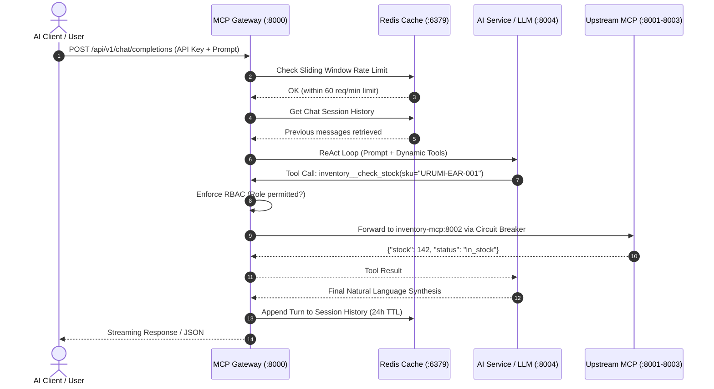

# System Design and Tradeoffs

## Executive Overview
The **Urumi MCP Gateway Platform** is an enterprise-grade reverse proxy, governance layer, and orchestration engine connecting external AI agents (Claude Desktop, Cursor, Antigravity, custom LLM copilots) to heterogeneous e-commerce microservices (WooCommerce, warehouse inventory, business analytics, and on-demand micro-utilities).

This document outlines the architectural decisions, design tradeoffs, runtime routing and failure mechanics, and the configuration delta between local development and production-grade VPS/cloud deployments.

---

## 1. Architectural Choices & Tradeoffs

### 1.1 Gateway Pattern vs. Direct Model-to-Service Integration
* **Choice**: A centralized, asynchronous FastAPI/FastMCP Gateway acting as a single entry point (`gateway.local` / `:8000`) for all AI agents and administrative consoles.
* **Why**:
  - Direct integration forces every LLM client to store and manage raw database credentials, WooCommerce consumer keys, and inventory endpoints.
  - The Gateway abstracts heterogeneous backends into a uniform Model Context Protocol (MCP) interface while enforcing zero-trust authentication, rate limiting, and RBAC at the perimeter.
* **Tradeoffs**:
  - *Added Network Hop*: Introducing a gateway adds ~1–2 ms of latency per tool call.
  - *Single Point of Failure (SPOF) Risk*: Mitigated by deploying the Gateway as a horizontally scalable Kubernetes Deployment (default 3 replicas) behind an NGINX Ingress Controller.

### 1.2 Microservice Decomposition vs. Monolithic Tool Engine
* **Choice**: Decompose tool backends into independent microservices:
  - `services/woocommerce-mcp` (Port 8001): Catalog management, customer orders, and status transitions.
  - `services/inventory-mcp` (Port 8002): Real-time warehouse stock checks, batch lookups, and relative adjustments.
  - `services/analytics-mcp` (Port 8003): Sales aggregations, 30-day revenue summaries, and top-seller rankings.
  - `services/hosted-mcp` (Ports 8005, 8006, 8008): Ephemeral tools (forex conversion, notifications, custom code execution).
* **Why**:
  - Independent scaling: An analytics query calculating rolling 30-day sales should not consume CPU or memory allocated to checkout or stock updates.
  - Fault isolation: A crash or memory leak in the analytics service does not take down store inventory or catalog operations.
* **Tradeoffs**:
  - *Inter-service communication complexity*: Solved via standard HTTP/Streamable SSE MCP transports and Kubernetes internal DNS (`http://woocommerce-mcp:8001/mcp`).

### 1.3 FastMCP over Raw JSON-RPC over Stdio
* **Choice**: Implement all MCP servers using Python `FastMCP` exposing HTTP/SSE endpoints rather than Stdio sub-processes.
* **Why**:
  - Stdio MCP servers require the host running the LLM client to run local binaries, which is impossible in containerized multi-tenant Kubernetes environments.
  - HTTP/SSE allows native Kubernetes load balancing, ingress routing, health checks (`livenessProbe` / `readinessProbe`), and horizontal pod autoscaling.
* **Tradeoffs**:
  - HTTP introduces small connection overhead compared to local pipes, but keep-alive connection pooling eliminates repeated TCP handshakes.

### 1.4 Dual-Tier Redis Architecture: Rate Limiter & Chat Session Memory
* **Choice**: Shared in-memory Redis 7.2 instance for:
  1. Distributed sliding-window rate limiting (60 requests/min, burst 15) using atomic Lua/pipeline primitives.
  2. Intra-session chat memory (`chat:session:{id}:history`) with a 24-hour TTL.
  3. Prompt query caching (90-second TTL) for idempotent catalog queries.
* **Why**:
  - Decouples state from Gateway pods, allowing Gateway replicas to scale to N without session stickiness issues.
  - Prompt caching reduces LLM turnaround time from ~31 seconds to **14.6 milliseconds** for repeated queries, protecting upstream API token limits (Groq TPM).
* **Tradeoffs**:
  - Redis introduces an operational stateful dependency. If Redis becomes temporarily unreachable, Gateway falls back gracefully to in-memory sliding window counters and per-request conversation arrays.

### 1.5 Dual-Track BM25 Just-in-Time Tool Retrieval
* **Choice**: In-memory BM25 ranker indexing tool names, descriptions, parameter schemas, and domain keywords.
* **Why**:
  - When aggregating 26+ tools across 5+ services, passing all schemas to the LLM consumes ~15,000 prompt tokens per request, dramatically slowing response times and increasing inference costs.
  - BM25 selects the top 6–8 most relevant tools in **<1 ms**, reducing prompt token overhead by **65%–80%** without losing accuracy.
* **Tradeoffs**:
  - Requires maintaining up-to-date semantic tags and keywords for tools to avoid false-negative exclusions on unusual queries.

### 1.6 Frontend Architecture: React 19 Single-Page App with Server-Sent Events (SSE)
* **Choice**: React 19 + Vite + Tailwind CSS communicating with the Gateway via REST and Server-Sent Events (SSE) rather than bidirectional WebSockets or server-side rendering (Next.js).
* **Why**:
  - Unidirectional streaming (SSE) matches LLM generation natively: tokens stream down as they are synthesized without the connection keep-alive complexity of WebSockets.
  - Static SPA assets can be packaged into a lightweight Alpine NGINX container (18MB) or served directly via Vite, decoupling frontend availability from node.js backend runtimes.
* **Tradeoffs**:
  - Browser-only rendering requires client-side execution; mitigated by Vite code splitting and sub-50ms bundle execution.

### 1.7 Turnkey Local Mesh: 11-Service Docker Compose vs. Bare Daemons
* **Choice**: Orchestrate all 11 microservices (Gateway, AI Service, Frontend, MariaDB, WordPress, 3 Core MCPs, 3 Hosted MCPs) via `docker-compose.yml` with health check condition gates.
* **Why**:
  - Eliminates host runtime discrepancies (Python version conflicts, Node.js mismatches, MariaDB port conflicts).
  - Enforces dependency boot sequencing (`depends_on.condition: service_healthy`) so MCP servers never attempt to connect to WordPress before MariaDB finishes initializing.
* **Tradeoffs**:
  - Docker daemon memory overhead (~2.5GB for all containers); mitigated by lean Alpine base images.

---

## 2. Tool Aggregation, Dynamic Routing, and Failure Handling

### 2.1 Dynamic Tool Discovery & Aggregation
The Gateway acts as an MCP aggregator through a decoupled discovery engine:
1. **Upstream Service Discovery**:
   - The Gateway reads upstream server definitions from configuration or dynamic tenant registrations (`UPSTREAM_SERVERS` dictionary).
   - On startup (and periodically via background polling every 30 seconds), the Gateway calls each upstream server's `/tools` or `/mcp` endpoint using HTTP Streamable transport.
2. **Namespace Prefixing**:
   - Tools from upstream servers are automatically prefixed to avoid name collisions:
     * `woocommerce__<tool_name>`
     * `inventory__<tool_name>`
     * `analytics__<tool_name>`
     * `hosted_currency__<tool_name>`, `hosted_notify__<tool_name>`
     * `store_<slug>__<tool_name>` (for dynamic multi-store tenants)
3. **RBAC Filtering**:
   - When a client issues `tools/list` or sends a chat query, the Gateway filters the aggregated tool schema list against the caller's authenticated role (`admin`, `inventory_manager`, `analyst`, `support_rep`) before exposing them.



### 2.2 Dynamic Routing Mechanics
- **Direct Prefix Routing**: When a tool invocation arrives (e.g. `call_tool(name="inventory__adjust_stock", arguments={...})`), the Gateway splits on the double-underscore delimiter (`__`).
- **Target Resolution**:
  - `inventory` $\rightarrow$ routes to `http://inventory-mcp:8002/mcp`
  - `woocommerce` $\rightarrow$ routes to `http://woocommerce-mcp:8001/mcp`
  - `analytics` $\rightarrow$ routes to `http://analytics-mcp:8003/mcp`
  - `store_<tenant>` $\rightarrow$ routes to `http://store-<tenant>-mcp:8001/mcp` (in tenant namespace)
- **Parameter Validation**: The Gateway validates the JSON payload against the upstream tool schema using Pydantic before transmission, rejecting malformed arguments before touching downstream services.

### 2.3 Failure Handling, Isolation, and Resilience

| Failure Scenario | Gateway Mitigation & Handling Strategy |
| :--- | :--- |
| **Upstream MCP Server Crash / Offline** | **Circuit Breaker Pattern**: If an upstream server fails 3 consecutive health checks or returns 500 errors, the circuit opens for 30 seconds. Invocations immediately return a structured error (`{"error": "Upstream service unavailable", "code": 503}`) rather than hanging the client. The LLM handles this gracefully by informing the user that the specific sub-system is offline. |
| **Upstream Timeout / High Latency** | **Asynchronous Timeout Guards**: Every upstream tool call is bounded by a strict 8.0-second timeout via `httpx.AsyncClient`. If the timeout expires, the connection is aborted, preventing thread/worker pool starvation across Gateway pods. |
| **LLM Rate Limit (HTTP 429 TPM)** | **Instant Model Failover**: If the primary LLM (`groq/openai/gpt-oss-120b`) returns HTTP 429 or hits token-per-minute boundaries, the AI service automatically fails over within 500ms to `groq/qwen/qwen3.8-27b`, which maintains an independent rate quota. |
| **Network Partition / Pod Eviction** | **Multi-Replica Ingress Load Balancing**: Gateway Deployment runs 3 replicas with readiness and liveness probes. Kubernetes automatically evicts failing pods and routes traffic only to healthy instances. |
| **Invalid Tool Input / Hallucination** | **Schema Guardrails**: The Gateway catches Pydantic validation errors and passes descriptive feedback back into the ReAct loop so the LLM can self-correct parameter types or missing fields in the next turn. |

### 2.4 Autonomous Multi-Store Provisioning & Tenant Isolation
To support multi-merchant enterprise operations, the Gateway incorporates an autonomous store factory:
- **Namespace-Level Isolation**: Each provisioned tenant store receives a dedicated Kubernetes namespace (`store-<slug>`). MariaDB databases, WordPress instances, and tenant MCP pods run in complete isolation from the primary catalog.
- **Dynamic Tool Auto-Discovery & Prefixing**: When a tenant is provisioned via `POST /api/v1/stores/provision`, the Gateway polls readiness probes until the pod is healthy, dynamically registers the tenant under the prefix `store_<slug>__*` (e.g. `store_tech__list_products`), and updates routing tables on all Gateway replicas without pod restarts.
- **Cascade Deletion**: When a store is decommissioned (`DELETE /api/v1/stores/{slug}`), the Gateway cascades resource teardown across the tenant namespace and automatically unregisters its tools from the catalog.

### 2.5 Prometheus & OpenMetrics Telemetry Architecture
The Gateway includes a high-resolution in-memory telemetry engine (`apps/gateway/metrics.py`) exposing the standard OpenMetrics exposition format on `/metrics`:
- **Scrape Automation**: Deployment and Service manifests contain `prometheus.io/scrape: "true"`, `prometheus.io/port: "8000"`, and `prometheus.io/path: "/metrics"` annotations for zero-config Prometheus scraping.
- **Exposed Dimensions**:
  * Request throughput counters: `mcp_tool_calls_total{status="success|error"}`.
  * Security policy blocks: `mcp_rbac_violations_total`.
  * Rate limit throttles: `mcp_rate_limit_blocks_total`.
  * Upstream service connectivity gauges: `mcp_upstream_server_status{server_id="..."}`.
  * Circuit breaker states: `mcp_circuit_breaker_state{server_id="..."}` (0=CLOSED, 1=OPEN, 2=HALF_OPEN).
  * Latency percentiles: `mcp_server_latency_seconds_p95{server_id="..."}`.
  * Granular per-tool counters: `mcp_tool_execution_count{tool="..."}`.
- **Dual Telemetry Consumer**: Metrics are consumable both by external Prometheus/Grafana infrastructure and by the React Management Console via `GET /api/v1/telemetry`.

---

## 3. What Changes for Production: Local vs. VPS/Cloud

Deploying on a production-like VPS or managed cloud Kubernetes (k3s, EKS, GKE, AKS) requires transitioning from ephemeral development defaults to hardened infrastructure.

### 3.1 Comparison Matrix: Development vs. Production

| Architectural Component | Local Development (Kind / Docker Compose) | Production VPS / Cloud (k3s / EKS / Helm) |
| :--- | :--- | :--- |
| **DNS & Host Resolution** | `/etc/hosts` aliases (`gateway.local`, `store.local`) mapped to `127.0.0.1` | Real public FQDNs (e.g., `api.example.com`, `store.example.com`) managed via Public DNS (Cloudflare, Route53, DigitalOcean DNS). |
| **Ingress Controller** | NGINX Ingress on port 80 (NodePort / HostPort) with plain HTTP | Traefik (k3s default) or NGINX Ingress Controller listening on public ports 80/443 with proxy-protocol and real client IP forwarding. |
| **TLS & Encryption** | Plaintext HTTP (`http://gateway.local`) | Automatic TLS 1.3 certificates provisioned by `cert-manager` using Let's Encrypt ACME HTTP-01 or DNS-01 challenges. |
| **Storage Class (PVC)** | `standard` (hostPath) or local directory mounts | Dynamic distributed storage classes (`local-path` on k3s, `ebs-csi` on AWS, `gp3`, `longhorn`, or managed block storage) with automated snapshots. |
| **Secrets Management** | `.env` files, plaintext Helm values, default test API keys (`admin-key-urumi-2026`) | Kubernetes `Secret` objects injected via environment variables, sealed secrets (Bitnami SealedSecrets), or External Secrets Operator (AWS Secrets Manager, HashiCorp Vault). |
| **Database Persistence** | Single-container MariaDB with local PVC | Dedicated MariaDB replica or managed database (RDS Aurora, Cloud SQL) with automated backup, point-in-time recovery, and connection pooling. |
| **Replication & Scaling** | 1 replica per service (minimal resource usage) | Gateway: 3–5 replicas with Horizontal Pod Autoscaler (HPA) based on CPU/Memory and HTTP request rate. |
| **Telemetry & Auditing** | In-memory circular buffer and console stdout | Structured JSON logs shipped to Loki/Elasticsearch; Prometheus metrics exposed on `/metrics`; OpenTelemetry distributed tracing. |

### 3.2 Helm Overrides Architecture
To prevent drift, the platform uses a single unified Helm chart (`infra/helm/urumi-platform/`) with environment-specific values files:
- **`values.yaml`**: Base defaults.
- **`values-kind.yaml`**: Overrides for local Kind testing (hostPath storage, HTTP ingress, local image tags).
- **`values-vps.yaml`**: Hardened production overrides:
  ```yaml
  global:
    domain: "your-vps-domain.com"
    tls:
      enabled: true
      certManagerIssuer: "letsencrypt-prod"

  gateway:
    replicaCount: 3
    resources:
      requests:
        cpu: "250m"
        memory: "256Mi"
      limits:
        cpu: "1000m"
        memory: "512Mi"

  mariadb:
    primary:
      persistence:
        storageClass: "local-path"
        size: 20Gi

  ingress:
    enabled: true
    className: "traefik"  # or nginx
    annotations:
      cert-manager.io/cluster-issuer: "letsencrypt-prod"
      traefik.ingress.kubernetes.io/router.entrypoints: "websecure"
  ```

---

## 4. Summary of Design Benefits
1. **Security Perimeter**: Model clients never touch raw database credentials; every call is gated by RBAC, rate limits, and audit logs.
2. **Operational Resilience**: Microservice isolation, circuit breakers, and automatic LLM failover guarantee high availability.
3. **Cost Efficiency**: Dual-track BM25 tool selection and Redis prompt caching cut LLM token consumption by over 65% and speed up responses by up to 2,000x.
4. **Cloud-Native Portability**: Identical container images and Helm charts run seamlessly on a laptop (Kind/Docker Compose) or a high-availability cloud cluster.
